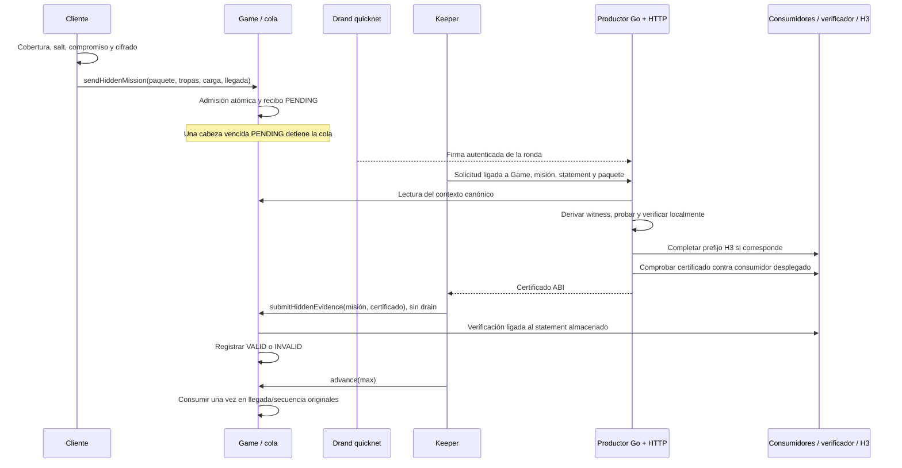

# Especificación de implementación: misiones ocultas v2

Versión documental: 1.0, 10 de noviembre de 2026.
Repositorio de referencia: Vendetta on-chain, rama `feat/hidden-v2-local-mpc-review`,
base `c84b9f6393e57025df4c3648ec59f7fe4dc6c040` **más los cambios de trabajo**.
El commit por sí solo no contiene todo el estado descrito. Para reproducirlo se
necesita el árbol completo, incluidos los archivos nuevos todavía sin commit.

Distribuir este documento junto con las fuentes y vectores enlazados si se exige
reproducción byte a byte: no contiene los grandes CS/PK/VK, dependencias instaladas
o evidencias originales externas. Su ausencia no se sustituye por hashes inventados.

Este documento especifica el protocolo implementado, sus interfaces y el trabajo
que falta para producir una versión de producción. Permite construir una
implementación compatible o adaptar el diseño a otro juego. No constituye una
aprobación de seguridad. Las claves actuales son experimentales y el despliegue
en redes reales está bloqueado. Una implementación independiente debe conservar
los invariantes y validar sus propias dependencias, circuitos y artefactos.

## 1. Objetivo y alcance

Una misión válida debe resolverse en su llegada y orden originales aunque su
certificado se publique tarde. El remitente no debe perder un ataque válido por
estar desconectado, por una caída del keeper o por tardar el productor.

Se implementan conjuntamente:

1. Cifrado temporal del tipo y destino de la misión.
2. Compromiso que impide cambiar esos datos después del envío.
3. Admisión atómica con identidad y contexto inmutables.
4. Pruebas de apertura o invalidez verificadas por contratos.
5. Cola global cronológica con frontera ante evidencia pendiente.
6. Productor HTTP, keeper, caché, journaling y exclusión entre procesos.
7. Proyección cliente y operación local con mundos efímeros.

No se implementan estado privado general, tropas privadas, anonimato del
remitente, disponibilidad garantizada ni recuperación de mundos Anvil locales.
No existe un protocolo v1 desplegado que haya que migrar. V2 es obligatorio desde
la inicialización de cada mundo; no hay activación opcional ni ruta alternativa
de revelación directa.

La especificación normativa del juego está en [B-22 y B-07/B-08](spec/blockchain.md).
Su precedencia es `docs/spec/blockchain.md` > `docs/spec/decisions.md` > capítulos
legacy. Hay residuos contradictorios en esa documentación: el resumen de B-07
habla de aparcar/reinsertar, B-08/B-26 usan «reveal» de la ruta anterior y B-20
sugiere omitir misiones desconocidas en la previsión. Para v2 quedan reemplazados
por el cuerpo específico de B-22 y las reglas de los apartados 10 y 16 de este
documento, coherentes con la implementación actual: no hay aparcado/revelación
directa y el forecast se detiene en la frontera pendiente. No copiar esos resúmenes
antiguos como requisitos nuevos. Reglas y vectores proceden de `docs/spec/data/*.yaml`; los generados no
se editan manualmente. Algunos comentarios del código dicen todavía «opt-in» o
«research v1»: no autorizan mezclar protocolos ni contradicen la admisión v2 fija. También es
obsoleto el NatSpec de lista aparcada sobre `playerOf` en `Game.sol`; esa función
no devuelve misiones aparcadas.

## 2. Privacidad y supuestos de confianza

| Dato                                               | Durante el viaje | Desde la publicación de la ronda; apertura computable |
| -------------------------------------------------- | ---------------- | ----------------------------------------------------- |
| Tipo de misión                                     | Cifrado          | Público                                               |
| Coordenadas de destino                             | Cifradas         | Públicas                                              |
| Salt del compromiso                                | Cifrado          | Recuperable/público con la apertura                   |
| Propietario, origen y existencia del envío         | Públicos         | Públicos                                              |
| Tipos y cantidades de tropas                       | Públicos         | Públicos                                              |
| Recursos transportados                             | Públicos         | Públicos                                              |
| Cobertura, llegada, ronda, compromiso y ciphertext | Públicos         | Públicos                                              |
| Tropas, recursos y edificios del mundo             | Públicos         | Públicos                                              |

La apertura se hace computable cuando drand publica la ronda (prevista para
`arrival+15`), aunque el productor no haya publicado aún un certificado. No hay
que esperar el certificado para que otros puedan descifrar. Una evidencia
invalid-point temprana puede hacer pública la invalidez estructural antes de la
llegada; no revela un destino válido ni adelanta la ejecución.

Los cuatro tipos actuales son `ATTACK=1`, `STATION=2`, `TRANSPORT=3`, `OCCUPY=4`.
Espionaje no es un quinto tipo de este paquete. El ocultamiento no elimina
inferencias por tropas, carga, cobertura, origen o actividad pública.

La interfaz utiliza misiones ocultas salvo transportes vinculados a una operación
del mercado, que son públicos. La API pública de misiones también sigue existiendo.
El remitente conoce su propio plaintext y puede divulgarlo voluntariamente.

Supuestos que deben declararse en cualquier implementación:

- La cadena y su política de finalidad determinan la historia canónica.
- Drand quicknet no libera la capacidad de apertura antes de su ronda. Sus
  participantes podrían comprometer la confidencialidad si quebrantan ese supuesto.
- El cifrado, hashes, pairing, circuitos y sistema de pruebas son correctos.
- El setup Groth16 tiene procedencia aceptable y no conserva una trampa explotable;
  **esto no está acreditado para las claves experimentales actuales**.
- Los consumidores/verificadores instalados son los previstos. La administración
  de upgrades del proxy sigue siendo una frontera de confianza.
- Productor/keeper aportan disponibilidad, no autoridad para decidir validez sin
  prueba. Un productor malicioso puede negar servicio; no debe poder inventar un
  certificado aceptado, bajo los supuestos anteriores.

La privacidad es temporal, no permanente. Las pruebas se generan después de que
la apertura sea pública y contienen datos públicos de descifrado. «ZK» no significa
que el destino permanezca oculto después de resolver.

## 3. Arquitectura



Componentes equivalentes en una implementación nueva:

| Responsabilidad                | Referencia actual                                                              |
| ------------------------------ | ------------------------------------------------------------------------------ |
| Cifrado, apertura y calendario | `apps/web/src/chain/codec.ts`, `hidden.ts`                                     |
| Reglas y simulador             | `packages/rules/src/hidden.ts`, `src/sim/hidden-*.ts`, `missions.ts`           |
| Admisión y contexto            | `contracts/src/core/HiddenAdmission.sol`, `HiddenContext.sol`                  |
| Recepción y ciclo de vida      | `HiddenEvidence.sol`, `HiddenResolution.sol`                                   |
| Cola y efectos del juego       | `Game.sol`, `core/Missions.sol`, `Heap.sol`, `Settlement.sol`                  |
| Consumidores y prefijo exacto  | `contracts/src/hidden/{MissionV2Consumer,InvalidPointV2Consumer,H3Prefix}.sol` |
| Circuitos y productor nativo   | `apps/web/scripts/experiments/opening-zk/`                                     |
| Servicio HTTP y supervisor     | `apps/web/scripts/prover.ts`, `scripts/prover/`                                |
| Operador de misiones           | `apps/web/scripts/keeper.ts`, `scripts/keeper/`                                |

## 4. Tipos, enteros y separación de dominios

Todos los cálculos de reglas deben usar enteros exactos, con los mismos redondeos
en TS y Solidity. En TS se usa `bigint`. Los decimales JSON de valores grandes
se transportan como strings. No convertir uint256 o identificadores grandes a
`Number` de JavaScript.

En el perfil actual: `missionId`, propietario y secuencia usan dominios de uint64;
la llegada almacenada es uint40; cobertura uint32; salt uint256; coordenadas del
plaintext son bytes. La ronda se serializa uint64 big-endian pero se restringe a
`1..2^53-1` para compatibilidad entre implementaciones.

No confundir:

- Keccak-256 de Ethereum con SHA3-256 estandarizado.
- SHA-256 de integridad de archivos con Keccak-256 de contexto/compromiso.
- La curva BLS12-381 del timelock/drand con BN254 del Groth16/verificador EVM.
- Los estados `VALID/INVALID` del recibo con `ACCEPTED/EXHAUSTED` de H3.

## 5. Cobertura, viaje y calendario

### 5.1 Geometría y costes

Perfil actual: 50 ciudades, 50 barrios y 255 posiciones, con 17 columnas y 15 filas.
Para coordenadas base 1 `(city, neighborhood, slot)`:

```text
x = (city - 1) * 17 + ((slot - 1) mod 17)
y = (neighborhood - 1) * 15 + floor((slot - 1) / 17)
n = (x1-x2)^2 + (y1-y2)^2
s = floor(sqrt(n))
distanceGrid = s + (n >= s*s+s+1 ? 1 : 0)
distance = distanceGrid * DISTANCE_UNIT
DISTANCE_UNIT = 1000
```

El emisor declara `cover` en unidades de cuadrícula: `1 <= cover <=` distancia a
la esquina más lejana. El destino real debe estar dentro de esa cobertura.
La política cliente actual, con `u` uniforme en `[0,1)`, es:

```text
d = distanceGrid(origin, target)
pad = max(ceil(d/2), 20)
cover = min(d + floor(u*(pad+1)), maxDistanceGrid(origin))
```

Es una política de disimulo, no una garantía de anonimato ni una exigencia de que
el contrato pueda comprobar la aleatoriedad del cliente.

Tiempo y salario se calculan con `cover * DISTANCE_UNIT`, no con la distancia
oculta exacta. Se usa la velocidad mínima del grupo, capacidad sumada y salario
por unidades según investigación/reglas. Las fórmulas exactas de referencia están
en `contracts/src/rules/Map.sol` y `packages/rules/src/map.ts`:

```text
travelSeconds = round(3600 * ((distance * 33479/10000) / speed)^(1/5))
salary = floor(distance^(4/5) * totalSalaryUnits) / 2512, con división entera final
```

Se implementan mediante potencias/rangos enteros, no floats. El salario se paga
además de la carga. Si hay carga, carga+salario debe caber en la capacidad. Las
reglas de tropas autorizadas, propiedad del origen, suspensión, vacaciones del
emisor, máximo de misiones y costes normales siguen vigentes. **La admisión oculta
no conoce el target**: los controles de propiedad/vacaciones del destinatario del
envío público no se ejecutan allí. No deben filtrarse mediante una llamada on-chain
que publique el target. Véase su tratamiento histórico en el apartado 10. Tras recibir tropas, el edificio
tiene cooldown de 30s antes de enviarlas; no se elimina por usar misión oculta.

### 5.2 Ronda y llegada fija

Constantes del perfil:

```text
quicknetGenesis = 1692803367   # Unix seconds
quicknetPeriod = 3            # seconds
HEAD_START = 15               # release ocurre DESPUÉS de la llegada
SEND_MARGIN = 20
HIDDEN_ARRIVAL_SLACK = 30      # tolerancia del contrato respecto a la llegada natural
release(r) = genesis + (r-1)*period
release(r) = originalArrival + 15
```

El cliente calcula `natural = now + travelSeconds`, elige la primera ronda con
`release >= natural+20+15` y fija `arrival=release-15`. Con ese `now`, añade 20..22s
a la llegada natural. Al incluirse la transacción, el contrato vuelve a calcular
su propia llegada natural: exige `natural <= arrival <= natural+30`. Si el envío
llega tarde (`TooLate`), el cliente debe recalcular ronda/llegada y volver a cifrar;
no reutilizar el paquete con otra llegada. `InvalidArrival` rechaza llegadas por
encima de `natural+30`; un reloj cliente adelantado puede provocarlo. Ambos controles
usan `block.timestamp`. Aunque la ABI acepta `arrival=0` para tomar la natural,
el paquete debe seguir satisfaciendo la igualdad exacta con la ronda: el cliente
v2 debe enviar la llegada explícita calculada, no confiar en 0.

Esta relación es criptográfica y de admisión. La latencia real de publicación de
drand, generación, gas e inclusión puede ser mayor;15s no es un SLA. Acelerar el
reloj de Anvil no publica firmas futuras de drand.

## 6. Plaintext y compromiso

Formato binario fijo de 37 bytes; offsets desde 0, intervalos con final excluido:

| Offset | Longitud | Contenido                                          |
| ------ | -------- | -------------------------------------------------- |
| 0      | 1        | Versión `0x02`                                     |
| 1      | 1        | Tipo de misión 1..4                                |
| 2      | 1        | Ciudad 1..50                                       |
| 3      | 1        | Barrio 1..50                                       |
| 4      | 1        | Posición 1..255                                    |
| 5      | 32       | Salt uint256 big-endian, aleatorio mediante CSPRNG |

No es JSON, no admite campos opcionales, variantes de longitud ni orden distinto.
El JSON usado para guardar borradores del navegador no es el formato criptográfico.

```text
commit = keccak256(abi.encode(
  uint256(owner), uint256(kind), uint256(city), uint256(neighborhood),
  uint256(slot), uint256(salt)
))
```

`owner` es el identificador numérico `playerId` uint64, **no una dirección de
wallet/controlador**. Son seis palabras ABI completas de 32 bytes. No usar `abi.encodePacked` ni recortar
salt al campo escalar del SNARK. Deben preservarse todos sus 256 bits.

## 7. Paquete temporal fijo

El ciphertext de admisión tiene exactamente 273 bytes:

| Rango       | Longitud | Contenido                                              |
| ----------- | -------- | ------------------------------------------------------ |
| `[0,4)`     | 4        | ASCII `VDH2`, hexadecimal `56444832`                   |
| `[4,36)`    | 32       | Identidad de red quicknet                              |
| `[36,44)`   | 8        | Ronda uint64 big-endian                                |
| `[44,140)`  | 96       | Punto U comprimido BLS12-381 G2                        |
| `[140,156)` | 16       | V de la cápsula IBE                                    |
| `[156,172)` | 16       | W de la cápsula IBE                                    |
| `[172,204)` | 32       | MAC del header age                                     |
| `[204,220)` | 16       | Salt del payload age, distinto del salt del compromiso |
| `[220,257)` | 37       | Payload cifrado                                        |
| `[257,273)` | 16       | Tag de autenticación del payload                       |

Identidades fijadas en el perfil actual:

```text
NETWORK = 52db9ba70e0cc0f6eaf7803dd07447a1f5477735fd3f661792ba94600c84e971
PUBLIC_KEY_HASH = b667bf8a4eb1ee843c15c266cea12de2f2b23a108086fcc414c31b0c4b8949fc
RULES_DIGEST = ca68555c4e55b79b4e357509f49c61947b4ceac1ed174d51350db9069a8d1f40
PROFILE = 92753eff1c77eda7c8a75a867f4ec66bbe983b31f5cc379974fea3e3b1e35bdd
```

`PUBLIC_KEY_HASH=keccak256(bytes de la clave pública quicknet comprimida)`.
`PROFILE=keccak256(abi.encode(keccak256("vendetta-opening-research-v1"), RULES_DIGEST))`.
La etiqueta histórica del perfil no habilita un protocolo de misión v1.
`RULES_DIGEST = keccak256(UTF8(JSON.stringify([rulesets.vendetta, gameConfig])))`
según `apps/web/scripts/experiments/opening.ts`, usando el orden/contenido exacto
de los datos exportados de `@vendetta/rules`/`@vendetta/spec-data`. No es JSON
canonicalizado por orden alfabético de claves. `export-mission.ts` y
`mission_input.go`/`checkMissionRulePin` contrastan el perfil. Para otro juego,
versionar la derivación, regenerar el perfil y alinear todos los consumidores.
**Sólo se reutilizan esa derivación de RULES_DIGEST y de PROFILE del helper
histórico `opening.ts`**: `statementDigest`, `parseEnvelope`, `validatePlain` y
`evaluateOpening` de ese archivo son investigación V1 (texto, armor y dominio
anteriores), no referencia de codec/contexto v2. Para v2 rigen `codec.ts`,
`hidden-context.ts`/`HiddenContext.sol` y las relaciones v2.
La clave pública completa G2 comprimida es (una línea, 96 bytes):

```text
83cf0f2896adee7eb8b5f01fcad3912212c437e0073e911fb90022d3e760183c8c4b450b6a0a6c3ac6a5776a2d1064510d1fec758c921cc22b0e17e63aaf4bcb5ed66304de9cf809bd274ca73bab4af5a6e9c76a4bc09e76eae8991ef5ece45a
```

Está fijada también en `opening-zk/beacon.go`. Comprobar sus bytes contra
`PUBLIC_KEY_HASH`, no obtener otra clave del request.

### 7.1 Cifrado compatible

El cliente usa `tlock-js` y su IBE `encryptOnG2RFC9380`, con la clave quicknet
fijada y `SHA256(uint64BE(round))` como identidad. Genera una file key aleatoria
de 16 bytes. La cápsula es `U || V || W` de 128 bytes. Debe mantenerse la misma
convención de compresión y subgrupo. La identidad usa HashToG1 con el mismo DST
que la firma BLS del apartado 11 y `U=r·G2gen`. El orden de serialización GT debe
coincidir con **el cliente cifrador tlock-js/noble** (`fp12ToBytes`), no con una
serialización elegida por el prover; `producer_input.go` usa `gt.Bytes()` y esa
compatibilidad debe contrastarse con vectores.

Header canónico de 290 bytes, codificado UTF-8/ASCII, saltos LF:

```text
age-encryption.org/v1\n
-> tlock {round decimal rellenado a 16 dígitos} {NETWORK hexadecimal minúsculo}\n
{base64 de la cápsula, sin '=', líneas de 64 caracteres}\n
---
```

Las líneas anteriores representan concatenación de bytes: hay un único LF tras
cada línea y ninguno después de `---`. No insertar líneas vacías.

```text
headerKey = HKDF-SHA256(fileKey, salt vacío, info="header", length=32)
MAC = HMAC-SHA256(headerKey, header)
payloadKey = HKDF-SHA256(fileKey, payloadSalt16, info="payload", length=32)
nonce = 11 bytes cero || 0x01
payload = ChaCha20-Poly1305.seal(payloadKey, nonce, plaintext37, AAD vacío)
```

Es el perfil age de un único chunk final, no un parser age genérico. La reconstrucción
del archivo binario para las APIs age es:

```text
ageFile = header || ASCII(" ") || base64SinPadding(MAC32) || LF || body69
```

Su armor aplica Base64 estándar de `ageFile`, padding `=`, líneas 64,
`BEGIN/END AGE ENCRYPTED FILE` y LF final exactamente como `codec.ts`.

Para portar a otro lenguaje, usar los vectores de
[codec-v2](benchmarks/timelock-opening/codec-v2/vectors.json) y las implementaciones
`codec.ts`, `capsule_age.go`, `producer_input.go` como corpus de conformidad.
No basta con que «se pueda descifrar»: los bytes canónicos se hashean y forman
parte del statement. `ageFile` y armor sólo sirven para las APIs de cifrado:
el contexto v2 hashea **packet 273**, no armor ni `ageFile`.

## 8. Contexto inmutable y statement

La admisión construye 640 bytes:20 palabras ABI de 32 bytes big-endian, sin prefijo
ni longitud dinámica. Campos en este orden exacto:

| Índice | Valor                                                                   |
| ------ | ----------------------------------------------------------------------- |
| 0      | `keccak256("VENDETTA_OPENING_V2")`                                      |
| 1      | Chain ID de ejecución                                                   |
| 2      | Dirección del proxy Game, rellenada con ceros a la izquierda a 32 bytes |
| 3      | ID de misión                                                            |
| 4      | PROFILE                                                                 |
| 5      | `playerId` del propietario, no su dirección de wallet                   |
| 6..8   | Ciudad, barrio y posición del origen                                    |
| 9      | Cobertura                                                               |
| 10..13 | Los cuatro recursos de carga, en orden del ruleset                      |
| 14     | Llegada original                                                        |
| 15     | Ronda del paquete                                                       |
| 16     | NETWORK                                                                 |
| 17     | PUBLIC_KEY_HASH                                                         |
| 18     | Compromiso                                                              |
| 19     | `keccak256(paquete273)`                                                 |

```text
statement = keccak256(context640)
```

Los campos vienen de storage y del contexto de ejecución. No se acepta como
verdadero un contexto enviado por el solicitante HTTP. Las tropas no se agregan
arbitrariamente a estas 20 palabras: ya están almacenadas en la misión; el recibo
conserva además su secuencia. Cambiar el esquema exige nueva versión coordinada
de circuito, consumidores y clientes.

No usar el helper histórico `MissionContext.Define` con su dominio V1 por defecto:
la relación actual llama `defineWithDomain(..., "VENDETTA_OPENING_V2")`.

Esta unión evita reutilizar pruebas entre misiones, Games, cadenas, ciphertexts,
compromisos, perfiles o llegadas distintos. El consumidor recibe siempre el
statement almacenado por Game, no un expected root elegido por el relayer.

## 9. Admisión, storage y ABI del juego

`Game.initialize` recibe consumidores opening e invalid-point con código y los
fija para el mundo. Cada admisión copia esos bindings a `HiddenEvidenceState`,
fuera de su campo `receipt`. Comprobar que una
dirección tiene código no certifica la seguridad del contrato ni del setup.

Interface principal, con longitudes de tropas/recursos del ruleset:

```solidity
sendHiddenMission(
  uint64 building, bytes32 commit, uint32 cover,
  uint256[TROOPS] troops, uint256[RESOURCES] resources,
  bytes ciphertext, uint40 arrival
) returns (uint64 mission);
submitHiddenEvidence(uint64 mission, bytes certificate) returns (bool changed);
getHiddenEvidence(uint64 mission) returns (bytes encodedState);
hiddenConsumers() returns (address opening, address invalidPoint);
advance(uint256 max) returns (uint256 processed);
recall(uint64 mission);
```

La admisión hace controles normales, descuenta tropas/carga/salario, asigna ID y
secuencia, crea misión en heap y valida framing/calendario/contexto en **una única
transacción**. Emite `MissionSent` con tipo/coordenadas 0 y
`HiddenMissionSent(id, commit, cover, ciphertext)`. Un fallo revierte costes,
contadores, IDs y secuencia.

No se rechaza en admisión un U/MAC/payload inválido con framing correcto: su
invalidez opaca se certifica posteriormente. Por tanto existe riesgo de bloqueo
por basura pendiente, además de por misiones honestas.

Eventos necesarios para seguir el ciclo de vida (ABI exacta en `GameErrors.sol`):

| Evento                                                                     | Cuándo                            |
| -------------------------------------------------------------------------- | --------------------------------- |
| `MissionSent(id, player, origin, kind, city, neighborhood, slot, arrival)` | Admisión; kind/target 0 si oculta |
| `HiddenMissionSent(id, commit, cover, ciphertext)`                         | Paquete de la admisión oculta     |
| `HiddenEvidenceRecorded(id, valid)`                                        | Primer resultado registrado       |
| `MissionRevealed(id, kind, city, neighborhood, slot)`                      | Consumo de apertura VALID         |
| `HiddenMissionInvalidated(id)`                                             | Consumo de INVALID                |
| `MissionReturning(id, arrival)`                                            | Inicio de retorno                 |
| `MissionRecalled(id, arrival)`                                             | Recall                            |
| `MissionEnded(id)`                                                         | Fin de misión                     |

Los IDs de misión son indexados; `MissionSent.player` también lo es. Los eventos
de combate/ocupación ordinarios siguen emitidos por sus rutas. No confundir el
evento de evidencia con ejecución de los efectos. Si no quedan tropas, `_sendBack`
termina directamente con `MissionEnded` sin emitir `MissionReturning`.
`getHiddenEvidence` sobre ID desconocido devuelve tuple a cero/status 0; sólo
`submit` para recibo desconocido revierte.

Estado por misión, en orden de estructura:

```text
receipt = {
  statement: bytes32, arrival: uint40, seq: uint64,
  status: uint8, consumed: bool, plain: bytes
}
evidence = {
  receipt, openingConsumer: address, invalidPointConsumer: address,
  cancelled: bool
}
```

`getHiddenEvidence` devuelve un `bytes` que contiene `abi.encode(evidence)`;
no es JSON. La respuesta ABI externa envuelve un `bytes` dinámico; un cliente como
viem lo desenvuelve al leer el contrato. Esos bytes interiores contienen el tuple
dinámico `HiddenEvidenceState` y su offset inicial por el campo `plain`. Decodificar
el tuple completo, no asumir que el primer word es `statement`. La referencia
cliente para decodificarlo es `apps/web/src/chain/hidden-evidence.ts`.
Storage debe respetar B-17: anexar campos donde corresponda, no reutilizar códigos
persistidos ni introducir reordenamientos de un mundo ya desplegado.

## 10. Máquina de estados y frontera cronológica

Estados del recibo: `0=desconocido`, `1=PENDING`, `2=VALID`, `3=INVALID`.

| Operación                  | Precondiciones                                           | Resultado                    |
| -------------------------- | -------------------------------------------------------- | ---------------------------- |
| initialize                 | No existe recibo, misión admitida                        | PENDING con identidad fija   |
| recordVerified válido      | Prueba aceptada, mismo statement, plaintext 37 versión 2 | VALID y plaintext            |
| recordVerified inválido    | Prueba aceptada, mismo statement, plaintext vacío        | INVALID                      |
| Repetir evidencia idéntica | Mismo status y plaintext                                 | No cambia; `changed=false`   |
| Evidencia conflictiva      | Estado o plaintext distinto                              | Revert                       |
| consume                    | Llegada vencida, no PENDING, no consumido                | Marca consumed una vez       |
| Recall                     | Propietario autorizado y antes de llegada                | Evidencia cancelada/inactiva |

`initialize`, `recordVerified` y `consume` son operaciones internas del motor;
no exponer `recordVerified(valid, plain)` como setter público. En el simulador TS,
`EvidenceVerifier` es una frontera confiable inyectada para el modelo/tests, no
una autorización que pueda elegir un jugador ni un sustituto del verificador EVM.

Cualquier cuenta puede presentar evidencia; no se exige permiso de keeper ni del
remitente. Para una misión activa, cada certificado se verifica aunque su resultado
repita uno previo: «idéntica» significa mismo status y plaintext, **no mismos bytes
de proof**. Si la misión está cancelada, retornando, eliminada o ya no oculta,
`submit` devuelve false sin verificar el certificado; un recibo desconocido revierte.
Por tanto un conflicto sólo se evalúa si la misión sigue activa.

La evidencia no ejecuta combate ni drena la cola. Debe poder entrar aunque la
cabeza esté bloqueada: `submitHiddenEvidence` **no lleva** el modifier de drain.

La cola es un heap global ordenado por `(arrival, seq)`. Al procesar:

```text
while presupuesto y hay cabeza vencida:
    si cabeza oculta saliente y recibo PENDING: detenerse, sin quitarla
    comprobar reserva de gas
    retirar cabeza
    consumir recibo si es histórica
    si INVALID: iniciar retorno desde originalArrival
    si VALID: comprobar identidad y plaintext; aplicar reglas normales en esa llegada
```

Las acciones de juego que usan `drained` procesan como máximo 4 misiones y revierten
con `Backlog` si aún queda una cabeza vencida. `advance(max)` permite progresar en
varias transacciones; una cabeza PENDING produce ausencia de progreso, no un
certificado de invalidez. La reserva actual es 7M gas por misión más 100k para la
ruta histórica; es una constante del motor que debe contrastarse con sus tests,
no un presupuesto inventado para otro contrato.

**Impacto operativo: una sola cabeza vencida PENDING impide las acciones con
drain de todos los jugadores**, incluidas registro de nuevos jugadores, construcción, investigación, entrenamiento,
envíos, mercado, familias/guerras, abandono, poke, inicio/fin de vacaciones,
aceptaciones de transferencia/controlador/sesión y recall. `submitHiddenEvidence`, `advance` y las lecturas siguen
siendo accesibles. `revokeSession`, `cancelRemoval`, `cancelTransfer` y `cancelInvite`
no drenan; tampoco los roles administrativos (`setRole`, `proposeRole`,
`acceptRole`), premium global/individual, suspensión o la ruta de upgrade UUPS.
Mantienen sus propias autorizaciones/reglas. Las listas son ilustrativas: el
modifier `drained` de cada función en `Game.sol` es la referencia exacta.
`transferPlayer`, `inviteController`, `authorizeSession` y `removeController`
también drenan. Estar autorizado durante vacaciones/suspensión no significa
poder saltarse ese drain. Es una detención global del
juego dependiente de drain, aunque no detenga la cadena ni todas las funciones.

La frontera impide que acciones posteriores de juego alteren el estado sobre el
que debía resolverse un ataque anterior. No se debe describir como pausa de toda
la blockchain o de todas las funciones administrativas. No implementar una
frontera sólo por edificio: hay dependencias compartidas de propietarios,
investigación, mercado e identificadores.

No hay caducidad, gracia que cancele una misión válida, lista de aparcadas ni
reasignación de llegada. Invalidar criptográficamente no significa perder un
combate: la misión inválida retorna desde su llegada original. Una misión válida
puede perder, rebotar o ejecutar otras reglas ordinarias. Reverts revierten también
consumo y dequeue. El recall posterior a la llegada no permite saltarse el bloqueo.

Invariante obligatorio: `opening.valid=1` implica **todas** las comprobaciones
estáticas defensivas de `_applyReveal`: mismo compromiso con `owner=playerId`,
kind/coordenadas válidos, target distinto del origen, distancia dentro de cover
y carga compatible. Una discrepancia deja una cabeza VALID que revierte siempre,
con riesgo de bloqueo global. No «resolverla» descartando la misión por timeout.
Las condiciones dinámicas ordinarias deben resolver por sus resultados/retornos,
no introducir reverts por destinos que puedan cambiar legítimamente. Errores
inesperados de ejecución preservan estado y requieren diagnóstico; este documento
no promete ausencia absoluta de reverts en código defectuoso. No existe una ruta
operativa de saltar/descartar una cabeza VALID que siempre revierte: la corrección
puede requerir un upgrade administrativo si sigue autorizado; un mundo congelado
sin esa facultad no obtiene recuperación automática.

En el motor actual se consulta el ocupante del target al resolver. ATTACK contra
slot vacío/edificio propio retorna; STATION exige edificio propio; OCCUPY exige
slot vacío y tropas de ocupación suficientes. Para vacaciones ocultas se comprueba
la siguiente condición exacta sobre el registro de vacaciones del propietario
del target almacenado al resolver:

```text
m.start < vacationUntil &&
(vacationStart < m.start || (vacationStart == m.start && vacationSeq < m.seq))
```

`Account.startVacation` escribe el último vacationStart/vacationSeq, por lo que no
es una consulta a un historial ilimitado de vacaciones. En un viaje suficientemente
largo, una nueva vacación iniciada antes de la llegada puede sustituir el registro
que cubría el envío; la fórmula ya no reconoce esa vacación anterior. No cambiar
silenciosamente esta semántica por una consulta histórica completa al portar.
El control se ejecuta
antes del dispatch de kind y aplica a cualquier misión oculta con target no vacío.
TRANSPORT acredita carga al ocupante del edificio de destino aunque sea de otro
jugador; si el slot está vacío, la carga se pierde. Un transporte oculto no lleva
trade asociado. El cliente debe informar ese riesgo antes de cifrar. Esta regla de envío/orden no se sustituye por «está de
vacaciones ahora». El cliente puede anticipar restricciones, pero no es autoridad.

## 11. Relaciones criptográficas

### 11.1 Opening: apertura autenticada y validez estática

`MissionV2Circuit`, Groth16 sobre BN254. Combina:

1. Autenticación BLS de firma quicknet para la ronda exacta.
2. Descompresión/relación de puntos y pairing de la cápsula BLS12-381.
3. Derivación de file key y consistencia de la cápsula con H3 exacto.
4. Header age canónico, HKDF/HMAC, ChaCha20-Poly1305 y autenticación de payload.
5. Hash del paquete completo y enlace con contexto 640/statement.
6. Predicado estático de misión y booleano de salida `valid`.

Quicknet utiliza firmas mínimas G1 y clave pública G2. La firma comprimida mide 48
bytes. El mensaje BLS es `SHA256(uint64BE(round))` y el DST exacto es
`BLS_SIG_BLS12381G1_XMD:SHA-256_SSWU_RO_NUL_`. No sustituir por otro esquema POP/G2,
otra red, otra ronda ni confiar en un booleano de un servidor de beacons.

Predicado de misión:

- Versión 2 y kind 1..4.
- Coordenadas en el dominio fijado y distintas del origen.
- Compromiso coincide preservando los 256 bits del salt.
- Distancia redondeada real dentro de cover.
- Carga cero salvo `TRANSPORT=3`.
- Todas las comprobaciones criptográficas previas necesarias son verdaderas.

`valid` debe ser **igual a la conjunción completa**, no una implicación que permita
al productor escoger false. La propiedad/ocupación/vacaciones y combate dependientes
del mundo se evalúan por el motor en el instante histórico, no se «congelan» como
validez estática al enviar.

Cada flag intermedio (`CapsuleValid`, `HeaderValid`, `PayloadValid`) debe ser
**igual al resultado completo de su comprobación**, no un booleano que el witness
pueda bajar a 0 arbitrariamente. El plaintext debe ligarse al descifrado/keystream
exacto, el scalar al prefijo H3 exacto. `valid=1` implica `U=r·G2gen` y `r != 0`
por composición: `PairCircuit` excluye U identidad, `CapsuleValid` es igualdad
exacta con la multiplicación escalar y `valid` incluye ese flag. No es una
restricción aislada que prohíba scalar 0 en todo witness: la ruta EXHAUSTED necesita
poder representar 0 con CapsuleValid=false. El consumidor comprueba esa ruta y
las fronteras del gadget escalar deben ser probadas expresamente.
Una falsa rama de invalidez es tan peligrosa como aceptar un plaintext falso:
cualquiera podría certificar INVALID antes del resultado correcto.

Una firma de beacon falsa/no disponible no produce `valid=false`: no permite
construir la apertura autenticada. Un fallo RPC/proceso/timeout tampoco tiene
witness de invalidez por ese hecho.

### 11.2 Invalid-point: U inutilizable

`InvalidPointMissionV2Circuit` liga el mismo contexto y paquete 273 a un U que no
cumple la validación de punto requerida. Cubre decodificación, curva/subgrupo y
condiciones de identidad. La regla exacta es invalidar U si no es una codificación
comprimida canónica G2 (flags incorrectos, coordenadas fuera del campo o sin punto
en curva), **o** es infinito, **o** está fuera del subgrupo. La prueba sólo puede
ser construible si falla esa regla; la negación no puede depender de escoger la
otra raíz Y o de un hint no restringido. Deben coincidir `SetBytes` + controles
nativos y `compressedG2Valid` en `point_encoding.go`. No basta con rechazar una
longitud arbitraria ni con reducir coordenadas no canónicas módulo p.

No requiere firma drand, H3 ni cooperación del emisor. Puede demostrar invalidez
estructural antes de la ronda, pero el recibo no se consume antes de llegada.
El keeper y el endpoint productor actuales esperan el release antes de solicitar/
servir certificados; esa política operativa no limita la relación matemática.

Ambas rutas normalizan a un único INVALID del juego; no ofrecen al emisor una
opción entre «ejecutar por plaintext» y «abortar por ciphertext inválido».

### 11.3 H3 exacto y paginado

H3 deriva un scalar por rejection sampling. No reducir el número de intentos a
un límite de trabajo del prover y llamar inválida a la misión al agotarlo.

```text
GT = pairing(signatureG1, U)
pad2 = SHA256("IBE-H2" || serializeGT(GT))
sigma16 = V XOR pad2[0:16]
fileKey16 = W XOR SHA256("IBE-H4" || sigma16)[0:16]
pre = SHA256("IBE-H3" || sigma16 || fileKey16)
for i = 1..65534:
    h = SHA256(uint16LE(i) || pre)
    h[0] = h[0] >> 1       # sólo el primer byte, NO todo el digest
    candidate = uint256BE(h)
    aceptar el PRIMER candidate < FrBLS
```

`FrBLS=0x73eda753299d7d483339d80809a1d80553bda402fffe5bfeffffffff00000001`.
Regla normativa: `serializeGT` del circuito **debe ser idéntico** a
`fp12ToBytes` del cliente tlock-js/noble y a `gt.Bytes()` del productor nativo.
Son doce coeficientes canónicos Fp de 48 bytes big-endian, total 576 bytes. En la
notación Go se concatenan:

```text
C1.B2.A1 | C1.B2.A0 | C1.B1.A1 | C1.B1.A0 | C1.B0.A1 | C1.B0.A0 |
C0.B2.A1 | C0.B2.A0 | C0.B1.A1 | C0.B1.A0 | C0.B0.A1 | C0.B0.A0
```

En noble equivale a recorrer `fp12.c1,c0`, dentro `fp6.c2,c1,c0`, dentro
`fp2.c1,c0`; no se serializan valores Montgomery. El circuito `capsule.go`
convierte mediante `ToTower` y recorre esos doce elementos en orden inverso,
con cada campo codificado canónicamente. Los tres caminos deben coincidir
para los mismos elementos de pairing; cambiar de representación sin comprobarlo
puede producir una prueba INVALID para un ciphertext honesto, no sólo un error
de interoperabilidad. La conformidad exige vectores GT explícitos y pruebas
positivas/negativas de la relación, no confiar en el nombre del método del backend.
La igualdad de U con el generador multiplicado por scalar forma parte de la
consistencia de la cápsula; un scalar 0 no hace válida una U no identidad.

`H3Prefix` mantiene `(pre, scalar, next, acceptedAt, status)` y admite lotes 1..128.
Estados: `COMPUTING=1`, `ACCEPTED=2`, `EXHAUSTED=3`. Recorre en orden, sin saltar
rechazos. Sólo el consumidor admite el contexto mediante `begin`; cualquiera puede
avanzar un recibo existente. El wrapper público `MissionV2Consumer.begin(pre)`
no restringe al llamador y es idempotente: cualquiera puede solicitar que el
consumidor inicialice ese pre. No permite saltarse su posterior vínculo en la
prueba. El estado se comparte entre misiones con el mismo pre. El recibo se
identifica por:

```text
keccak256(abi.encode("VENDETTA_H3_PREFIX_V1", contextDigest, verifierId, pre))
```

El consumidor usa `contextDigest=pre` y `verifierId=keccak256("VENDETTA_H3_MISSION_V2")`.
El primer argumento de `abi.encode` es un **string dinámico**, con offset/longitud,
no un bytes32 prehasheado ni encodePacked. H3 no certifica por sí solo la misión:
la prueba debe ligar exactamente ese pre. Agotar 65534 candidatos requiere hasta
512 lotes de 128 pasos; ese coste no se elimina truncando la relación.

En ACCEPTED, el scalar público debe coincidir con el almacenado. En EXHAUSTED,
scalar debe ser 0 y los flags de cápsula/validez final deben ser false. COMPUTING,
pre desconocido o scalar distinto son rechazos/reintentos, nunca INVALID automático.

## 12. Certificado y esquema público

Certificado ABI:

```text
abi.encode(uint8 route, bytes proof, bytes encodedInputs)
route=1: encodedInputs = abi.encode(uint256[55])
route=2: encodedInputs = abi.encode(uint256[2])
```

`route` no es el tipo de misión. La prueba EVM del backend actual mide 384 bytes por usar un compromiso BSB22
más su PoK. Su layout `MarshalSolidity` es doce words de 32 bytes:

```text
Ar.X | Ar.Y | Bs.X1 | Bs.X0 | Bs.Y1 | Bs.Y0 | Krs.X | Krs.Y |
Commitment0.X | Commitment0.Y | PoK.X | PoK.Y
```

Son coordenadas BN254 no comprimidas, big-endian, sin prefijo de longitud de
slice. Los arrays 55/2 son los inputs públicos de aplicación; no se les añade el
hash derivado del compromiso, que gestiona el verificador exportado. No asumir
el layout estándar de otro exportador Groth16. Usar las opciones de
exportación/proving/verificación Solidity del gnark fijado, incluidos compromisos.
La ruta actual llama `groth16.Prove` con
`solidity.WithProverTargetSolidityVerifier(backend.GROTH16)`, `groth16.Verify` con
`solidity.WithVerifierTargetSolidityVerifier(backend.GROTH16)`, exporta mediante
`vk.ExportSolidity(writer)` y serializa con `proof.MarshalSolidity()`. No mezclar
claves/pruebas de otra configuración del backend.

Cada bloque packed representa 16 bytes big-endian en un uint128, rellenando con
ceros **a la derecha** el último bloque incompleto. El circuito comprueba ese
padding. Un bytes32 se divide en mitad alta **primero** y mitad baja después: `(high<<128)|low`.

Esquema exacto de 55 inputs opening, índices base 0:

| Índices | Contenido                                      |
| ------- | ---------------------------------------------- |
| 0..1    | Keccak del paquete                             |
| 2..4    | Firma comprimida 48 bytes                      |
| 5..12   | Cápsula 128 bytes                              |
| 13      | File key 16 bytes del KEM                      |
| 14      | CapsuleValid, booleano                         |
| 15      | File key 16 bytes de age, ligada a la anterior |
| 16..34  | Header canónico, 19 bloques                    |
| 35..36  | MAC32 bytes                                    |
| 37..41  | Body 69 bytes, 5 bloques                       |
| 42..44  | Plaintext 37 bytes, 3 bloques                  |
| 45      | HeaderValid, booleano                          |
| 46      | PayloadValid, booleano                         |
| 47      | Ronda                                          |
| 48..49  | Statement 32 bytes                             |
| 50      | Valid de misión, booleano                      |
| 51..52  | Pre 32 bytes                                   |
| 53..54  | Scalar 32 bytes                                |

Todos los inputs deben ser menores que 2^128 salvo los cuatro booleanos, que deben
ser 0/1. Se contrasta el orden real del witness Go con el consumidor, no se deriva
una ABI aproximada. Invalid-point tiene sólo las dos mitades del statement.

Los consumidores usan el verificador inmutable configurado y una llamada acotada
actualmente a 2M gas. Rechazan expectedStatement distinto, palabras no canónicas,
prueba inválida y, para opening, H3 incompleto/scalar/exhaustion incoherentes.
La ABI `verifyProof(bytes,uint256[N])` del export gnark **no devuelve bool**:
DEBE revertir si la prueba no es válida. Los consumidores actuales aceptan si la
llamada termina sin revert. Conectar un verificador que devuelva false sin revertir
aceptaría pruebas inválidas; si se usa esa ABI alternativa, el consumidor DEBE
comprobar explícitamente su bool. No asumir compatibilidad sólo por el nombre.

Sólo tras verificar devuelven `(valid, plain)`; `valid=false` puede ser una apertura
criptográfica correcta que demuestra un mensaje inválido. No equivale a que el
verificador haya rechazado la prueba.

El mayor sobre normal actual, opening, mide 2304 bytes y el invalid-point 608.
Caben en el límite cliente existente de 16384 bytes por certificado.

## 13. Productor HTTP y worker nativo

### 13.1 Identidad y API

Un servicio está ligado por configuración del operador a `(chainId, Game, RPC,
setups, runtime)`. El cliente no puede elegir un RPC ni un verificador arbitrario.

```http
POST /
Authorization: Bearer <token>
Content-Type: application/json

{"chainId":31337,"game":"0x...","mission":"123",
 "statement":"0x...","packet":"0x..."}
```

Los campos `context` adicionales del keeper no son autoridad; el servicio relee
misión, evidencia y consumidores al mismo bloque, deriva el contexto y compara
statement, llegada, secuencia, identidad y paquete con el binding almacenado.
Responde `200 {"certificate":"0x..."}`. `GET /metrics` requiere scope `metrics`.
No se acepta un `valid`, plaintext, file key o resultado esperado del solicitante.

Antes de servir: lease exclusivo, configuración válida, chain ID correcto,
manifests válidos según política, hashes del runtime desplegado ligados a esos
setups y consumidores correctos. La presencia de código no sustituye esos bindings.

### 13.2 Pipeline

1. Recuperar cualquier transacción H3 publicada cuyo resultado fuera ambiguo.
2. Leer y autenticar contexto; comprobar que la misión espera evidencia.
3. Inspección ligera del paquete para elegir opening o invalid-point.
4. Buscar caché por statement/contexto y digest del setup.
5. Si hace falta opening, obtener firma de la ronda y autenticarla nativamente y
   dentro del circuito; construir witness sin flags elegidos por el request.
6. Generar Groth16 y verificar la prueba con VK local.
7. Validar artefacto: kind/statement/setup, proof 384 bytes, número/dominio de inputs.
8. Preparar/reconstruir el prefijo H3 exacto si corresponde.
9. Consultar el consumidor real desplegado para verificar el certificado.
10. Codificar y devolver el sobre ABI.

Un worker residente carga CS/PK/VK una vez. Sólo hay un setup residente por servicio;
el cambio de circuito espera la salida del anterior. Mantiene comprobaciones de
integridad de artefactos incluso al reutilizarlos. Protocolo stdin JSON por línea,
control <=64KiB, con ID único por job y confirmación ligada al mismo ID. Respuestas
ajenas/duplicadas, EOF inesperado, crash, timeout o salida excesiva invalidan el
proceso; se mata y espera antes de liberar el turno/reintentar.

### 13.3 Límites y caché

| Límite actual             | Valor / alcance                                                   |
| ------------------------- | ----------------------------------------------------------------- |
| Cola serial               | Capacidad 8, deduplicación de requests idénticos                  |
| HTTP                      | 32 conexiones y 32 handlers, incluso tras desconexión del cliente |
| Headers / body de entrada | 8KiB /16KiB                                                       |
| Upload absoluto           | 10s; no es deadline de generación de prueba                       |
| Deadline nativo por job   | 900000ms por defecto, configurable; no incluye toda la cola       |
| Salida del worker         | Presupuesto 1MiB por job                                          |
| Caché de pruebas          | 64MiB, 4096 archivos, 7 días por defecto                          |
| Beacon HTTP               | 4KiB de cuerpo, 15s; autenticidad se comprueba criptográficamente |
| RPC / espera de recibo    | 15s sin retry de transporte /60s                                  |

La retención se ejecuta al iniciar y entre trabajos serializados; no es cuota
física de disco ni limpieza continua. No borra journals, lock ni archivos ajenos.
JSON truncado/forma/binding incorrectos se descartan como miss. Rechazo determinista
del consumidor evicta y cuenta `proofRejections`; RPC, `UnfinishedPrefix` y selectors
desconocidos conservan la prueba. Categorías deterministas:
`InvalidProof`, `WrongStatement`, `NonCanonicalWord`, `InvalidExhaustionClaim`,
`MismatchedScalar`. Esa clasificación presupone gas suficiente para la llamada de
verificación: un out-of-gas interno puede quedar envuelto en `InvalidProof`. La
simulación/eth_call debe provisionar gas suficiente y distinguir fallos de recurso;
el consumidor actual no distingue ese out-of-gas en su catch. Una eviction por ese
error puede desperdiciar trabajo, pero no registra INVALID: el certificado no fue
aceptado. No demuestra invalidez criptográfica de la misión.

Errores de mantenimiento no deben tapar el error primario ni descartar un
certificado válido. `cache.healthy=false` exige prune previo en la siguiente
petición. Las métricas son agregadas en memoria; reinician con el proceso y no
constituyen un sistema de alertas ni un SLA.

### 13.4 Autenticación y transporte de respuestas

Archivo privado JSON de clientes, máximo 128 entradas, tokens distintos de 32..128
caracteres `[A-Za-z0-9_-]`, scopes `prove`/`metrics`, requestsPerMinute y
maxConcurrent explícitos. Comparación de hashes SHA-256 de tamaño fijo mediante
`timingSafeEqual`; cuotas token bucket por proceso. 401 sin credencial, 403 sin
scope, 429 con Retry-After. La autorización se comprueba antes de leer el body.

El cliente keeper rechaza redirects, mantiene deadline 120s para headers/body y
señal de parada. Retiene como máximo 65536 bytes **decodificados** antes de
UTF-8/JSON; no confía en Content-Length. Exige certificate string hexadecimal de
bytes completos, no vacío, máximo 32770 caracteres incluyendo `0x` (16384 bytes).
Cancela cuerpos excesivos sin EOF y cuerpos de HTTP fallido sin parsearlos.

La cota no limita buffers internos de fetch/zlib, CPU de descompresión, JSON ni
RSS. El deadline cliente 120s puede terminar antes que un job nativo frío o en cola:
la desconexión no cancela ese trabajo; el reintento puede deduplicarse/usar caché.
Nunca convertir esta diferencia en expiración de misión. Logs controlados usan
mensajes/categorías estáticos sin URLs, bodies, tokens o errores remotos arbitrarios.

## 14. Keeper, reorg y transacciones persistentes

El keeper adquiere lease de su directorio privado antes de RPC y usa signer
dedicado. Cada tick:

1. Recuperar journal previo antes de leer misiones o preparar otro nonce.
2. Indexar ciphertexts de eventos canónicos desde el bloque de despliegue.
3. Leer misiones pendientes, ordenar por llegada/secuencia y buscar recibos PENDING.
4. Esperar llegada/release según política actual y solicitar certificado completo.
5. Simular la transacción de evidencia y publicar los mismos bytes firmados mediante
   journal durable antes del broadcast.
6. Ejecutar `advance(1)` con presupuesto de transacción 12M gas en el keeper actual;
   `advance(max)` es la API general. Dormir/reintentar fallos operativos. Un error
   de una misión aborta ese tick; el siguiente vuelve a intentar. No se promete
   reparto equitativo o ausencia de head-of-line blocking.

El índice comprueba el hash del checkpoint aun al servir un ID cacheado. Ante
reorg a menor/igual altura o cambio durante logs, descarta índice y reconstruye.
No se identifica una cadena sólo por chain ID ni se reciclan journals contra
un Anvil nuevo. Inclusión no equivale a finalidad; política de RPC/reorg/finalidad
para producción debe fijarse y probarse sobre el candidato real.

Journal compartido por productor H3 y keeper:

- Preparar y firmar localmente; comprobar parada antes de preparar, antes de firmar
  y después de firmar, antes de publicar.
- Publicar bytes firmados con temporal exclusivo, fsync, close, rename y fsync del
  directorio. Fallo de persistencia impide broadcast.
- Antes de reintentar, republicar durablemente **los mismos bytes**, no crear una
  transacción nueva con nonce diferente.
- Respuesta perdida/recibo desconocido/timeout conserva el journal. Sólo un recibo
  confirmado permite tratar success/revert como resultado y retirar estado con sync.
- Si ya se publicó el journal, la parada espera liquidación o conserva el journal;
  no abandona su ownership al recibir otra señal.
- Un nonce sustituido externamente puede bloquear la instancia. La política vigente
  es parar y preservar estado, diagnosticar y rotar a otro signer/directorio de forma
  controlada. No hay fee bump/cancelación automática ni borrado para «desatascar».

Fsync no demuestra resistencia física a fallos del almacenamiento. Son supuestos
el filesystem estable, directorios padre confiables y persistencia de estado;
backups/restauración y pruebas de corte del host final siguen siendo trabajo real.

## 15. Ciclo de vida y aislamiento operacional

Usar lease Linux util-linux `flock` con archivo persistente `.vendetta-state.lock`.
No borrarlo: eliminarlo puede permitir dos inodos bloqueados distintos. Validar
archivo regular/nlink/inodo y mantener el mismo descriptor heredado por hijos
nativos. Si muere el padre, un hijo vivo retiene el lease hasta salir. No existe
unicidad global del signer entre directorios diferentes: el operador debe usar
un signer/directorio dedicado por instancia/mundo.

SIGINT/SIGTERM/SIGHUP solicitan cierre cooperativo y repetido; SIGHUP no recarga.
Productor deja de admitir, cierra HTTP/inspecciones/worker/cola y libera lease al
final. Keeper cancela HTTP/sleep, deja de programar trabajo y conserva lease hasta
terminar el tick/operación publicada. Señal durante constructor se recuerda y no
abre listener después. Errores de operación y limpieza se conservan conjuntamente.
Un proceso externo debe matar descendientes tras crash o timeout de parada.

El entorno nativo se filtra también con overrides explícitos. Allowlist actual:
`PATH HOME TMPDIR LANG LC_ALL TZ GOGC PROVER_THREADS PROVER_MEMORY`.
GOMAXPROCS/GOMEMLIMIT derivan de PROVER_THREADS/PROVER_MEMORY, defaults 8/6GiB si
vacíos. No heredar H3/keeper keys, tokens, NODE_OPTIONS o LD_PRELOAD. Esto reduce
herencia accidental: no es sandbox de un binario hostil bajo el mismo UID.

Plantillas inertes `scripts/systemd/vendetta-{producer,keeper}.service`:
usuarios/grupos distintos, estado privado 0700, umask 0077, rutas de release/config
sólo lectura, temporales privados, sin cores, `KillMode=mixed`, retry 30s sin lockout
permanente. Contrastar configuración de estado con `STATE_DIRECTORY` del manager.
No instalar como mecanismo para saltarse la política del setup.
Fuentes exactas de estos límites: `prover/http.ts`, `jobs.ts`, `worker.ts`, `cache.ts`,
`access.ts`, `beacon.ts`, `environment.ts`, `scripts/state-lease.ts`, las plantillas
systemd y `.env.example`. Constantes de llegada/cooldown y fórmulas se generan desde
los datos de reglas en `contracts/src/generated/VendettaRuleset.sol`. Versiones:
`package.json`, `pnpm-lock.yaml` y `opening-zk/go.mod/go.sum`.

`TimeoutStopSec=150` es presupuesto de escalamiento, no garantía de cierre limpio
ante I/O colgado. MemoryMax/High, CPUQuota, TasksMax, disco, alertas y destino de
notificaciones necesitan evidencia y configuración del operador. El probe local
user-manager no acredita usuarios separados+hardening completo en el system manager.
Ese ensayo completo no está aceptado: faltó autorización no interactiva.

## 16. Integración cliente y experiencia de juego

- Generar salt y aleatoriedad en el dispositivo. Comprobar reglas locales antes
  de cifrar; el contrato no recibe el target para validar sus reglas dinámicas.
- Mostrar cobertura/coste/ETA y advertir que no se ocultan tropas ni origen.
- Guardar opcionalmente plaintext propio en almacenamiento local separado por
  Game/owner. Es conveniencia: perderlo no debe impedir resolución por terceros.
  No es protección frente a acceso al perfil del navegador o scripts del mismo origen.
  `allStoredPlains`, usado por el Workshop, puede reunir los borradores de todas
  las cuentas de ese navegador: las claves Game/owner no son aislamiento de seguridad.
- Cargar recibos y proyectar el estado hasta la frontera canónica. Conocer un
  plaintext propio no permite simular a través de una cabeza PENDING sin evidencia.
- El forecast devuelve ausencia de predicción al alcanzar esa frontera, no hace
  bucles sin progreso ni inventa un resultado provisional como estado confirmado.
- Mostrar reintento/espera para fallos de servicios. No ofrecer cancelación por
  timeout posterior a llegada ni botón de «revelar plaintext y ejecutar».
- En AA/sponsorship, usar la ruta normal de operación/transacción, conservando las
  mismas reglas; no introducir una vía de resolución diferente para wallets locales.

## 17. Herramientas, artefactos y preparación de un entorno

### 17.1 Dependencias fijadas

La reproducción exacta usa `pnpm-lock.yaml`, `go.mod/go.sum` y compilador Solidity
fijados. Estado observado: Node >=22 (validaciones con 24.22.1), pnpm 9.2.0,
Solidity 0.8.28, gnark 0.16.4 (commit `e974abb44722dd201a7f1949baeabca0fef5866e`),
gnark-crypto `v0.21.1-0.20260913224755-1409fe592052`, Go de validación 1.27.3
(go.mod declara mínimo 1.26.8). Copiar lockfiles; no usar `latest` para reproducir.
Linux/flock y filesystem estable son requisitos operativos actuales.

### 17.2 Artefactos por circuito

| Archivo                        | Función                                                      | ¿Necesario para operar?                 |
| ------------------------------ | ------------------------------------------------------------ | --------------------------------------- |
| `circuit.bin`                  | CS compilado                                                 | Sí, productor actual                    |
| `proving.key`                  | PK Groth16                                                   | Sí, generar pruebas                     |
| `verifying.key`                | VK Groth16                                                   | Sí, comprobación local/exportación      |
| `Verifier.sol`                 | Export exacto de VK                                          | Compilación y trazabilidad              |
| `manifest.json`                | Kind, profile, flags, dimensiones, SHA-256 de cuatro cuerpos | Sí                                      |
| Artefacto EVM del verificador  | Bytecode/ABI del compilador fijado                           | Desplegar y cotejar runtime             |
| `verifier-runtime.json`        | Bindings runtime/setup por circuito                          | Arranque del servicio                   |
| Recibos/transcripts/revisiones | Procedencia y trazabilidad                                   | Conservar; no todos se cargan al servir |

PK y VK no son las claves privadas de las cuentas. Pueden ser públicas; los
secretos temporales del setup no deben conservarse. Los signers Ethereum H3/keeper,
keys de usuarios y tokens HTTP sí son secretos operativos y no deben aparecer en
Git, navegador, argumentos de proceso, prompts o bundles de documentación.

Los artefactos grandes actuales están fuera de Git. Un clone/push no los transporta.
Para mover de PC: copiar fuentes completas, artefactos y recibos requeridos,
verificar hashes, ajustar rutas e instalar dependencias. No regenerar claves para
compensar una ruta distinta. Las fuentes congeladas no incluyen automáticamente
PK/CS ni todos los bytes de evidencia externos.

### 17.3 Configuración y arranque

Ver `.env.example` para todas las variables. Mínimos productor:
`HIDDEN_PROVER_BIN`, `HIDDEN_PROVER_KEYS` (padre de opening/invalid-point),
`HIDDEN_PROVER_RUNTIME`, `HIDDEN_PROVER_CLIENTS_FILE`, `HIDDEN_PROVER_CACHE`,
`HIDDEN_H3_PRIVATE_KEY` y deployment con chainId/rpc/game.
Keeper: deployment/fromBlock, `KEEPER_PRIVATE_KEY`, `KEEPER_STATE_DIR`,
`HIDDEN_PROVER_URL`, `HIDDEN_PROVER_TOKEN`. Nunca prefijar secretos con `VITE_`.

El listener productor es loopback. Acceso remoto requiere transporte TLS y controles
de conexión explícitos. Estado de servicios fuera de las raíces web/static.
Para supervisor, ejecutar Node directamente con loader tsx, sin shell/pnpm padre;
las plantillas documentan las rutas de ejemplo. Unidades no están instaladas. El launcher local rechaza `contracts/.env` para
evitar que Foundry cargue configuración de despliegue ajena a la sesión.

Ruta de desarrollo con artefactos existentes:

```bash
pnpm install --frozen-lockfile
# Preparar fuera del repositorio el config y pins del ejemplo enlazado.
bash scripts/dev-hidden-v2.sh /absolute/private/config.json /absolute/private/new-session
# Sólo en un mundo recién creado sin jugadores, una vez:
pnpm smoke:hidden-v2 /absolute/private/new-session
```

Ejemplo: [hidden-v2-local-stack.json](examples/hidden-v2-local-stack.json).
La ruta crea Anvil 31337, Game y signers nuevos, productor, keeper y web; usa
verificadores existentes y no solicita pruebas al arrancar. No exige Docker/indexer.
`dev:local` y fixtures E2E pueden usar consumidores mock: no acreditan criptografía.

Cada sesión Anvil es efímera. Directorio nuevo obligatorio; no existe `--resume`,
snapshot/checkpoint o restauración de partidas. Logs/build/cache quedan privados
y no se borran automáticamente. No reutilizar journals contra una cadena nueva.
La retirada de recuperación local no afecta journals/leases de cadenas persistentes.
No matar procesos por PIDs de recibos antiguos; comprobar identidad actual.

## 18. Setup y condiciones para producción

El protocolo de generación local ya se ejecutó para ambos circuitos; no se debe
repetir para actualizar conteos ni para producir otro documento. Sus beacons fijos,
identidades de test y operación bajo un único control no acreditan procedencia segura.

Política de arranque actual:

- `unsafeLocalSetup=true` sólo con opt-in explícito y chain IDs 1337/31337.
- `unsafeLocalSetup=false` se rechaza: la verificación de procedencia no está implementada.
- `Deploy.s.sol` rechaza redes distintas de 1337/31337.
- `deploy-gnosis.sh` aborta antes de leer secretos/contactar RPC.

Ningún booleano, hash calculado por nosotros ni review de Claude retira esas barreras.
El propietario trabaja sólo entre Codex y Claude, sin colaboradores externos; eso
permite desarrollo, pero no aporta participantes independientes o una autoridad real.

Una implementación que aspire a producción debe completar y revisar:

1. Congelación de circuito, reglas, orden de inputs, dependencias y build reproducible.
2. Procedimiento de setup con aleatoriedad impredecible y eliminación de secretos
   temporales; modelo de confianza explícito. MPC puede reducir confianza si al
   menos una contribución requerida es honesta y su secreto se elimina, bajo el
   protocolo correcto. Varias identidades bajo el mismo control no son independencia.
3. Transcripts/contribuciones/cierres/beacons autenticados y su vinculación real a
   CS/PK/VK; procedimiento de cierre y aleatoriedad posterior cuando lo requiera el plan.
4. Política auténtica de aprobación: quién decide, alcance, quórum, vigencia y
   revocación. No inventarla en un manifest ni confundir firmas de revisión de
   diseño con autorización de claves.
5. Importador/registro que ligue esas evidencias a fuente, CS, claves, Verifier.sol,
   compilador/opciones, runtime, consumidores, chain ID y Game. Rechazar sustitución,
   expiración, revocación y replay entre redes/circuitos.
6. Evaluación de seguridad de circuitos/adaptadores y correcciones verificadas.
7. Host candidato con usuarios/hardening/almacenamiento aceptados, recursos y carga
   objetivos medidos, alertas, financiación, TLS, dependencias, backups/restauración
   y política final de cadena/RPC/reorg/nonce.
8. Aceptación criptográfica/EVM/H3/World con los artefactos finales autorizados;
   las mediciones locales antiguas no son aceptación del candidato nuevo.

Las herramientas `inspect:artifacts-hidden-v2`, `check:vk-export-hidden-v2`,
`check:pk-structure-hidden-v2`, `check:lineage-hidden-v2` y
`preflight:archived-hidden-v2` aportan comprobaciones parciales concretas. Leer sus
flags/límites: integridad, framing, puntos o consistencia de recibos no equivalen
por separado a relación completa de claves, ceremonia segura o aprobación.

No se incluyen aquí instrucciones para ejecutar MPC/setup/proving del juego ni
para desplegar redes reales: esas operaciones están excluidas en la sesión actual
y requieren autorización específica y entradas reales. Para implementar desde
cero, planificarlas como un hito separado con revisión y presupuesto por operación.

## 19. Plan de construcción y criterios de aceptación

Orden de dependencias recomendado para una implementación independiente:

| Etapa | Entregable                                 | Criterio mínimo                                                 |
| ----- | ------------------------------------------ | --------------------------------------------------------------- |
| A     | Modelo TS/reglas exactas y heap global     | Mismos resultados con evidencia puntual y tardía                |
| B     | Codec/compromiso/contexto/calendario       | Bytes/digests idénticos entre lenguajes                         |
| C     | Receipts y adaptador de consumidores       | Ingreso sin drain, consumo único, no autoridad del relayer      |
| D     | Circuitos pequeños y rutas inválidas       | Positivos/negativos, sin invalidez por fallo de infraestructura |
| E     | Circuitos completos/export/consumidores/H3 | Esquema exacto, prefijo completo y pruebas no cruzables         |
| F     | Productor/worker/HTTP/caché                | Un setup residente, límites, timeout/reap y binding real        |
| G     | Keeper/index/journals/leases               | Recuperación con mismos bytes y sin nonce adicional             |
| H     | Cliente/proyección/operación               | No atravesar frontera pendiente; apagado/errores verificables   |
| I     | Artefactos/procedencia/host/candidato      | Evidencias finales auténticas y autorización de producción      |

Corpus mínimo de pruebas:

- **Codec:** cero/máximo salt, padding, cada byte/campo sustituido, tamaños incorrectos,
  red/ronda distintas, noncanonical points y parity TS/Go.
- **Binding:** cadena/Game/ID/arrival/owner/origin/cover/cargo/commit/hash cambiados,
  contextos con mismas dimensiones pero bytes distintos, sustituciones coherentemente
  repinneadas que deben fallar por semántica, no sólo por hash.
- **Criptografía:** firma auténtica de ronda incorrecta, firma falsa, punto fuera de
  curva/subgrupo/identidad, MAC/tag/compromiso/coords/carga inválidos, máximo salt,
  H3 primer candidato, rechazos previos, exhaustión y scalar 0; vectores GT que
  comparen cliente/circuito/productor a partir de los mismos `(signature, U)`,
  cubriendo pairing y serialización, no sólo empaquetado de un GT suministrado.
  Exigir satisfacibilidad de la rama exhausta
  mediante fixtures/modelos acotados apropiados y de las fronteras del gadget
  escalar, no sólo rechazo del certificado manipulado. Exigir que `ScalarMul(G,0)`
  sea la identidad y que no pueda igualar ninguna U válida no identidad.
  El test existente
  `h3-zero-boundary_test.go` aísla scalar 0/1/orden-1; no demuestra haber encontrado
  una preimagen SHA de exhaustión real ni es una nueva ejecución del circuito del juego. No presentar pequeños
  fixtures de sampling como cobertura del dominio del juego.
- **Consumidor:** todos los inputs/booleanos no canónicos, esquema real 55/2,
  prueba manipulada/cruzada, H3 desconocido/incompleto/scalar incorrecto/exhaustión.
- **Estados:** duplicados idénticos/conflictos, unknown, consumo doble, recall antes/
  después de llegada, revert atómico sin perder recibo/posición.
- **Orden:** permutaciones de evidencia, empates arrival/seq, ataques públicos,
  retornos y dependencias compartidas, retrasos largos; comparación de World completo
  con oráculo puntual, más diferencial TS/Solidity. Contrastar el predicado estático
  del circuito con `_applyReveal` en todo su dominio mediante límites, propiedades,
  vectores y fuzz apropiados: no basta con casos donde ambos rechazan por accidente. Igualar sólo balances no basta.
- **Operación:** desconexión, cuota, cuerpos lentos/excesivos/gzip, redirect sin token
  reenviado, stop antes/durante constructor/headers/body/firma/journal, crash idle,
  procesos nativos huérfanos, lease heredado, fallo sync/rename/FS, error+cleanup.
- **Persistencia/cadena:** broadcast minado con respuesta perdida, recibo inaccesible,
  reinicio/reorg a igual/menor altura, cambio de rama durante logs, nonce reemplazado;
  conservar journal y no preparar otro nonce ante ambigüedad.
- **Producción:** rechazo de manifests autodeclarados seguros, redes reales y registros
  no autorizados; bindings y trust-policy adversarios cuando exista esa política.

Pruebas de reglas: `packages/rules/test/hidden-*.test.ts` y escenarios generados.
Contratos: `contracts/test/core/Hidden*.t.sol`, escenarios/gas y consumidores bajo
`contracts/test/`. Circuitos: `opening-zk/*_test.go`; el orden ABI se verifica en
`mission_v2_schema_test.go`. Servicio: `apps/web/test/producer-*.test.ts`,
`keeper-*.test.ts`, `certificates.test.ts`, `state-lease*.test.ts`, `service-*.test.ts`.

Los tests con mock prueban wiring/reglas, no la relación criptográfica. Verificar
una copia archivada por SHA no es generar una prueba nueva. Un arranque con 0
requests/proofs no prueba el camino de misiones. Cada resultado debe fijar fuentes,
binarios, artefactos y alcance, sin sumar ejecuciones para inflar cobertura.

## 20. Estado comprobado y límites pendientes

- Ambos circuitos completaron el MPC experimental local. Se archivaron pruebas
  reales y replays con consumidores/Game/H3 y World puntual/tardío iguales.
- El servicio dispone de worker residente serial, autenticación/cuotas, caché,
  métricas, journals y leases, apagado cooperativo y entorno nativo filtrado.
- Cierre de operaciones persistentes del 7: 182 tests/27 archivos, ambos typechecks,
  seis revisiones reales de Claude y aceptación de productor sin proving.
- Cierre de transporte del 10: 33 tests/5 archivos, ambos typechecks, tres revisiones
  reales de Claude; fixtures HTTP/sintéticos, no pruebas criptográficas nuevas.
- Los límites físicos de producción, alertas, host completo con usuarios separados,
  capacidad/disponibilidad remotas, política final de cadena y procedencia/aprobación
  de claves no están acreditados. La frontera global sigue siendo un riesgo de
  disponibilidad y abuso que debe presupuestarse, no ocultarse mediante timeout.

Estos son resultados históricos con fuentes concretas, no una instrucción para
repetirlos. El desarrollo actual no autoriza MPC/init/FFT/sellado/setup keygen,
replay/proving del juego, publicación o despliegue en red real.

## 21. Índice de fuentes y continuidad

Para entender el estado vigente antes de ejecutar trabajo:

1. [CLAUDE.md](../CLAUDE.md).
2. [Handoff vigente; ignorar ACTIVO históricos](proposals/hidden-v2-session-handoff.md).
3. [Prompt de próxima sesión](proposals/hidden-v2-next-session-prompt.md).
4. [Operación de productor/keeper](service-operations.md).
5. [Stack local efímero](local-hidden-v2.md).
6. [Preparación de producción y gates](proposals/hidden-v2-production-readiness.md).
7. [Revisión real del transporte](reviews/hidden-v2-claude-certificate-transport-20261110.md).
8. [Auditoría de fuentes/bundles](proposals/hidden-v2-audit-bundle.md).
9. [Linaje](proposals/hidden-v2-receipt-lineage.md), [inventario de artefactos](proposals/hidden-v2-artifact-inventory.md),
   [VK/export](proposals/hidden-v2-vk-export-check.md), [PK](proposals/hidden-v2-pk-structure-check.md).
10. [MPC staged y resultados archivados](benchmarks/timelock-opening/local-mpc-staged/README.md).

Los documentos de propuestas contienen historial: no interpretar un pendiente
antiguo como vigente si el handoff posterior lo cierra o lo retira. Ante divergencia
entre esta síntesis y los bytes del protocolo, contrastar contra las fuentes y
vectores indicados, registrar la corrección y versionar conjuntamente todos los
consumidores afectados. No «arreglar» el formato sólo en un lenguaje.
