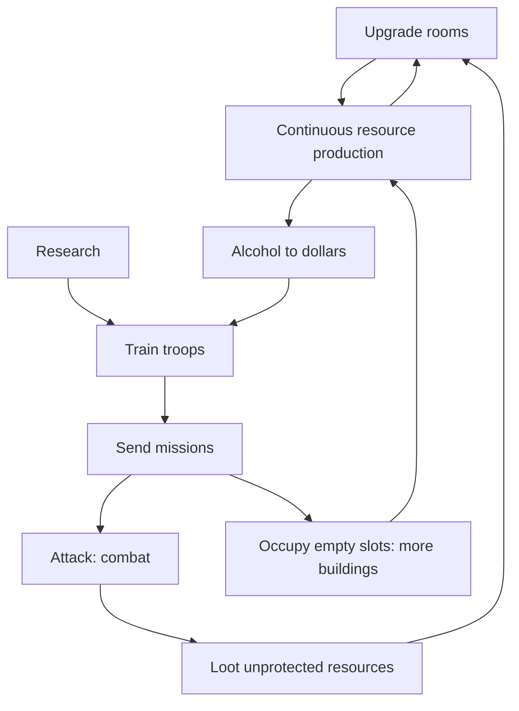

# Overview

## Genre

Vendetta is a **persistent multiplayer browser strategy game** with a mafia theme. Players own map
buildings, upgrade the rooms inside them, research techniques, train troops and send missions to
attack other players and steal their resources. Progress is measured in **points**.

## Core loop

1. **Build:** upgrade rooms in each building ([02-buildings.md](02-buildings.md)).
2. **Produce:** `weapons_armoury`, `ammunition_depot` and `brewery` produce continuously; `bar` and
   `smuggle` turn alcohol into dollars ([01-resources.md](01-resources.md)).
3. **Research:** per-player levels that unlock troops and boost their stats ([03-research.md](03-research.md)).
4. **Train:** attack troops in `boot_camp`, defense troops in `security` ([04-troops.md](04-troops.md)).
5. **Missions:** attack, station, transport or occupy ([07-missions.md](07-missions.md)).
6. **Combat:** pairwise stack fights with matchup modifiers; a winner that wipes the defender loots
   its unprotected resources ([06-combat.md](06-combat.md)).

## Core concepts

| Concept | Definition |
|---------|------------|
| Player | An account. Owns research levels, points, family membership. |
| Building (map building) | A coordinate `city:neighborhood:slot` owned by a player. Has its own rooms, resources, troops and queues. |
| Room | One of 15 upgradeable building types inside every building (legacy: *habitación*). |
| Research | One of 16 per-player techniques (legacy: *entrenamiento*). |
| Troop | One of 21 unit types; units belong to a building or to a mission in transit. |
| Mission | Troops (and cargo) travelling between two coordinates. |
| Ruleset | The data file defining all entities and their numbers ([data/vendetta.yaml](data/vendetta.yaml) or [data/space4k.yaml](data/space4k.yaml)). |

## World map

Coordinates are `city:neighborhood:slot`:

| Component | Range | Notes |
|-----------|-------|-------|
| City | 1–50 | |
| Neighborhood | 1–50 | |
| Slot | 1–255 | 17 columns × 15 rows grid |

A slot is either empty or holds exactly one building. Distance is computed on a global grid
([05-formulas.md](05-formulas.md#distance)). A player starts with one building and gains more only by
**occupation** missions. There is no limit on buildings, but the honor penalty reduces combat power
for large empires ([06-combat.md](06-combat.md#honor)).

## Time

Legacy advances state lazily on page loads and cron. The new implementation is a deterministic
event-driven simulation ([D-08](decisions.md#d-08--time-model--new)).
