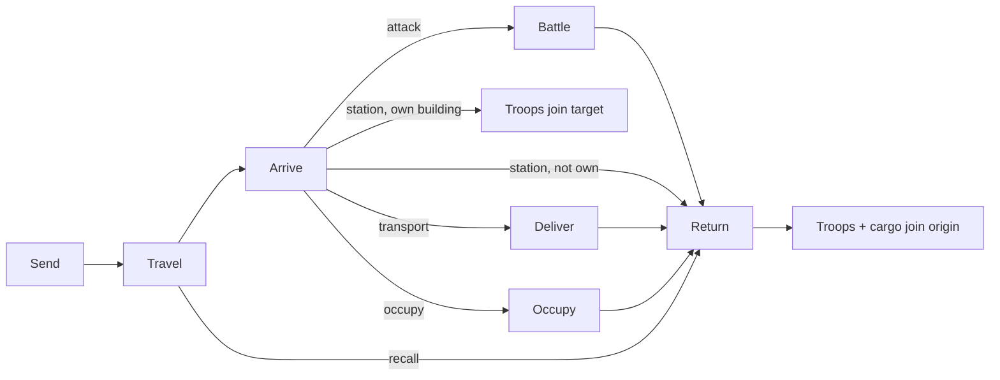

# Missions

**Sources:** `application/forms/Misiones.php`, `forms/Misiones/{Coordenadas,Tropas,Recursos}.php`,
`library/Mob/Controller/Plugin/Update.php::actualizarMisiones`, `application/models/Misiones.php`.

A mission moves **attack troops** (and, for transports, resources) from the player's current building
to a coordinate `city:neighborhood:slot`. Defense troops can never be sent.

## Mission types

| ID | Legacy key | Name | Effect on arrival |
|----|------------|------|-------------------|
| 1 | `mision_1` | **Attack** | Battle against the target building ([06-combat.md](06-combat.md)); survivors return with loot |
| 2 | `mision_2` | **Station** | Troops join the target building, which must be the sender's own; else they return |
| 3 | `mision_3` | **Transport** | Resources are delivered to the target building (any owner); troops return empty |
| 4 | `mision_4` | **Occupy** | Captures an empty slot if the mission includes an `occupation_troop` |
| 5 | `mision_5` | *Returning* | Internal: troops (and carried resources) re-enter the origin building |

There is **no espionage mission**; spying is a side effect of attacking with `spy` troops
([06-combat.md](06-combat.md#espionage)). Market trades are delivered with transport missions
([09-social.md](09-social.md#market)).

## Sending a mission

Inputs: troop quantities per attack troop type, target coordinate, mission type, and resources
(transport only; ignored for other types).

### Validation (legacy)

- Coordinates: city 1–50, neighborhood 1–50, slot 1–255.
- The target must not be the origin building.
- Attack: the target owner must not be the sender (also checked again on arrival).
- The target owner must not be on vacation ([09-social.md](09-social.md#vacation-mode)). This is
  checked only when sending; missions already travelling are unaffected.
- `resources[r] ≤ stock[r]` for each resource, where dollars must also cover the salary:
  `resources.dollar + salary ≤ stock.dollar`.
- `Σ resources ≤ cargo` where `cargo = Σ quantity × effective capacity − salary`.
- At least one unit (a mission with 0 units is silently not created).
- Legacy does not check server-side that the requested troops are available; target: it must
  ([D-22](decisions.md#d-22--server-side-validation--fix)).

### On send

1. Troops are removed from the origin building.
2. Resources (transport) **and the salary** are removed from the origin's stock.
3. The mission is created with `start = now`, `arrival = now + duration`.
4. If the target belongs to another player, that player is notified ("N troops of X are heading to
   your building … mission *type*"). The notice includes the mission type.

## Travel time

```
duration = round( ((distance × 3.3479) / v)^0.2 × 3600 )   # seconds
v = min effective speed of the troop types sent
```

`distance` from [05-formulas.md](05-formulas.md#distance). The return trip takes the same `duration`.

## Salary and cargo

```
salary = floor( distance^0.8 × Σ(quantity × salary_per_unit) / 2512 )   # dollars
cargo  = Σ(quantity × effective_capacity) − salary
```

The salary is **paid in dollars at send time** and is not refunded (not even on recall). It is paid
once per mission (the return trip is free). Effective capacity uses research `smuggling`.

## Mission lifecycle



### Arrival rules

- **Attack**
  - Target slot empty → notice "building does not exist"; troops return.
  - Target owned by the sender → notice; troops return.
  - Otherwise: battle. Survivors return carrying the loot. No survivors → nothing returns.
  - Before the battle, the defender's resources are brought up to date.
- **Station:** if the target is the sender's own building, troops (and any resources) are added
  to it; otherwise they return.
- **Transport**
  - Target owned by anyone: the resources are added to it (clamped by its storage capacity,
    [D-10](decisions.md#d-10--storage-overflow--keep)) and both players are notified.
  - Target owned by another player: market settlement may apply ([09-social.md](09-social.md#market)).
  - Empty slot: the resources are **lost** (legacy notifies "delivered" anyway).
  - Troops return empty.
- **Occupy**
  - Target slot empty and the mission contains ≥ 1 `occupation_troop` → a new building is created for
    the sender with the starting state in [game_config.yaml](data/game_config.yaml)
    (`occupation`: `boss_office` 1, 1,000 of each resource). One `occupation_troop` is consumed;
    **all** remaining troops return to the origin (none stay in the new building).
  - Without an occupation troop, or if the slot is taken: notice; troops return.
- **Return:** troops and carried resources are added to the original origin building (resources
  clamped by storage). If that building no longer belongs to the player, the troops and cargo are
  **lost** (`_estacionarTropas` checks ownership).

### Recall

A mission that is not yet returning can be recalled. It turns into a return mission arriving at
`now + (now − start)`: the time already travelled. Carried resources come back; the salary does not.

## Processing order (legacy)

Missions are processed lazily on page loads of either involved player (and by cron), in creation
order, inside one DB transaction. Target: event-driven by arrival timestamp
([D-08](decisions.md#d-08--time-model--new)).
