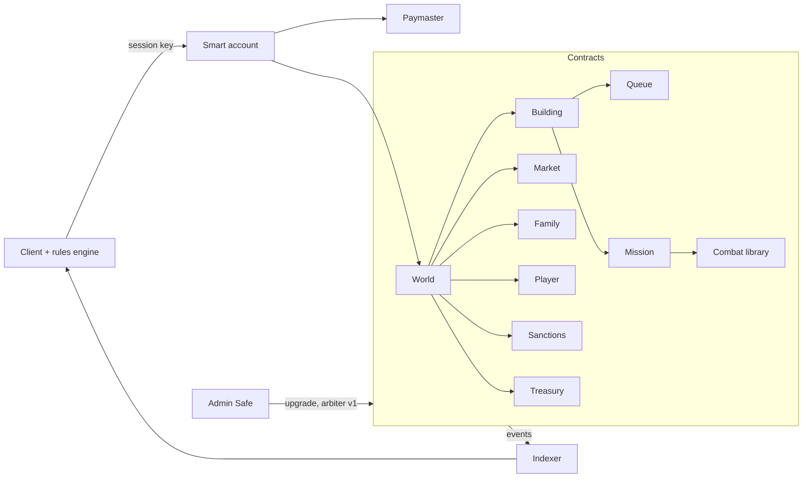

# Blockchain Implementation (EVM)

This file records the decisions needed to implement the target game ([decisions.md](decisions.md))
**fully on-chain** on an EVM network. It sits on top of decisions.md: when a B-xx decision and a
D-xx decision disagree, **this file wins for the on-chain implementation**.

Status: **Adapt** = changes a legacy or target rule so it fits the EVM · **New** = rule that only
exists on-chain · **Open** = not decided yet · **v2** = deliberately out of v1 scope.

## Goals and v1 scope

Why on-chain, all at once:

- **Trustless rules:** the contracts are the server. No operator can cheat, roll back or shut the
  world down (once frozen, B-17).
- **Persistent world:** the game outlives any company or server.
- **Asset ownership:** players own their state. Tokenization is postponed (B-04), but the design
  must not block it.
- **Technical experiment.**

v1 = the complete target game (resources, rooms, research, troops, missions, combat, market,
families, wars, vacation) with **all state and logic on-chain**, playable without the user knowing
which network it runs on. Messaging, chat and moderation are off-chain (B-10).

## Summary

| ID | Topic | Status | Summary |
|----|-------|--------|---------|
| B-01 | Network | New | Arbitrum One public L2, no own chain; code network-agnostic |
| B-02 | Language | New | Solidity; combat as an isolated library; no Stylus |
| B-03 | Fixed-point math | Adapt | `sqrt`, `^0.2`, `^0.8` and PHP rounding in fixed point; deviations listed with tolerance |
| B-04 | No tokens in v1 | New | Resources, troops and buildings live inside the contracts |
| B-05 | Public state | Adapt | All state is visible to everyone; `spy` / `espionage` unchanged |
| B-06 | Lazy settlement | Adapt | D-08 implemented as "settle on touch", no keepers |
| B-07 | Per-target ordering | New | Missions to a building resolve strictly in arrival order |
| B-08 | Chunked settlement | New | `advance(building, maxEvents)`; one event always fits in a block |
| B-09 | Hard caps | Adapt | Queue, mission and offer limits, configurable |
| B-10 | Off-chain social | Adapt | Messaging, chat, moderation off-chain |
| B-11 | Market | Keep | D-19 as is: no escrow, trust; non-delivery can be taken to Kleros |
| B-12 | Starting coordinate | Keep | Player chooses any free coordinate; no randomness needed |
| B-13 | Multi-accounts and bots | Keep | Everything allowed in v1 |
| B-14 | Sanctions module | New | `suspend(player, until)` by an `arbiter` role |
| B-15 | Accounts | New | Smart account, one passkey per device, recovery, session keys |
| B-16 | Gas | New | Low sponsored allowance; above it the player pays via credits |
| B-17 | Upgradeability | New | Proxy, no timelock, admin in a Safe; later frozen, one immutable deploy per world |
| B-18 | Events and indexer | New | Reports and notices as events; ranking in the indexer |
| B-19 | Points on-chain | Adapt | D-24 points kept incrementally on-chain |
| B-20 | Optimistic client | New | Client runs the same rules engine and projects results |
| B-21 | Parity tests | New | Foundry against the test vectors with explicit tolerances |
| B-22 | Hidden information | v2 | Commit-reveal for missions; FHE evaluated for defender state |
| B-23 | Arbitration | v2 | Kleros v2 as `arbiter`, under a written rulebook |
| B-24 | Tokenization | v2 | Out of v1 |
| B-25 | Premium | New | Longer queues for 30 days, paid with credits; admin can grant it to everyone |

---

## B-01 — Network — New

**Arbitrum One.** No own chain or app-chain. Reasons:

- Sub-cent cost for a typical action (estimated, see [assumptions](#assumptions-to-validate)).
- Kleros v2 runs on Arbitrum One, so the future arbiter (B-23) is a direct contract call, with no
  bridge.
- The RIP-7212 P-256 precompile exists, so passkeys are cheap to verify (B-15).

Gnosis Chain was evaluated (stable gas priced in xDAI). It was rejected because Kleros there needs a
cross-chain bridge and P-256 support is unconfirmed. It stays as plan B.

The contracts must not depend on Arbitrum-specific features (no Stylus, no ArbOS precompiles in game
logic), so the world can be deployed on another EVM network. The **network is invisible to the
player**: no network names, no bridging, no "get ETH" steps in the UI.

## B-02 — Language — New

Solidity. Combat (rounds, targeting, fights, loot) is a **pure library** with no storage access:
it takes the two armies and research levels and returns casualties and loot. This keeps it testable
in isolation and replaceable (e.g. by a Stylus port) if gas measurements ever show combat dominates
cost. Today's estimate is that storage writes, not combat, dominate, and Stylus does not make
storage cheaper.

## B-03 — Fixed-point math — Adapt

The EVM has no floating point. Every formula that uses `sqrt`, fractional powers or PHP `round()`
([05-formulas.md](05-formulas.md)) is implemented in fixed point:

| Formula | Non-integer operation |
|---------|-----------------------|
| Troop effective stats | `sqrt(levels)` |
| Distance | `sqrt(dx² + dy²)`, `round` |
| Travel time | `(…)^0.2`, `round` |
| Salary | `distance^0.8`, `floor` |
| Loss ratio | rounded to 3 decimals (D-15) |

Rules:

- Use one fixed-point library across all contracts (precision chosen in the prototype).
- Where an input domain is small and bounded (e.g. research levels, map distances), a **lookup
  table** is preferred over computing the function on-chain.
- Rounding is half away from zero, as PHP.
- Every vector that does not match exactly is listed here with its tolerance (`exact` or `±1`), and
  the on-chain implementation becomes the reference for that value (B-21).

*Deviation list: empty until the prototype is measured.*

## B-04 — No tokens in v1 — New

Resources, troops, research and buildings are **contract state**, not ERC-20 or NFT. They cannot be
transferred except through game mechanics (transport, market, loot). Tokenization is B-24.

## B-05 — Public state — Adapt

All on-chain state is readable by anyone: room levels, resources, troops, queues, missions in
transit. Consequences:

- The espionage side effect of attacks ([06-combat.md](06-combat.md#espionage)) gives no new
  information, since anyone can read the defender's rooms and resources.
- `spy` and `espionage` are **kept unchanged**. `espionage` still matters: it boosts the attack and
  defense of `spy` and `mercenary`. The report keeps the legacy spy rule, even though the information
  is public.

Hidden information is B-22 (v2).

## B-06 — Lazy settlement — Adapt

D-08 says the state at time `t` does not depend on when or how often it is computed. On-chain this
is implemented as **settle on touch**:

- Each building stores `lastUpdate`. Any transaction that reads or writes a building first brings it
  up to `block.timestamp`: integrates production, applies finished queue items, starts deferred items
  (D-11), and resolves arrived missions (B-07), all in timestamp order.
- **No keepers are required for correctness.** If nobody touches a building, its events wait. The
  result is the same whenever they are processed. Keepers (or the client) may advance state for
  convenience only.
- `resolveMission(id)` is public: anyone can call it once the mission has arrived.

## B-07 — Per-target ordering — New

A mission to building `B` can only resolve once every mission to `B` that arrived earlier is
resolved. Ties are broken by creation order (D-08). Resolving a mission first settles `B` up to the
arrival time, so the defender's state includes everything that happened before.

Because a player's action on `B` requires `B` to be settled to "now", arrived but unresolved missions
to `B` must be resolved first (B-08).

## B-08 — Chunked settlement — New

Settling a building may involve many events (up to the B-09 caps), which could exceed the block gas
limit and lock the building forever. So:

- `advance(building, maxEvents)` processes up to `maxEvents` pending events in order and stores the
  progress.
- A player action on a building that is not fully settled **reverts**. The client calls `advance`
  until it is settled, then retries.
- **Invariant:** one single event (the worst case is one combat) always fits in a block with room to
  spare. Target: **< 3M gas per combat**, to be measured.

## B-09 — Hard caps — Adapt

Legacy has unlimited troop queues and open offers ([05-formulas.md](05-formulas.md#queues),
[09-social.md](09-social.md#market)). On-chain every loop must be bounded. The starting values below
are to be tuned with gas measurements and live in the `onchain` section of
[data/game_config.yaml](data/game_config.yaml):

| Limit | Start value | Why |
|-------|-------------|-----|
| Troop batches queued per building (`boot_camp` / `security`) | 1, or 5 with premium (B-25) | Bounded settle |
| Pending missions **to** one building | 32 | Bounded settle; stops griefing a victim with cheap missions |
| Outgoing missions per player | 20 | Bounded state |
| Open market offers per player | 10 | Bounded state |

Room and research queue limits from legacy are kept. The number of buildings per player stays
unlimited: each building is settled separately, so it does not affect gas per transaction.

## B-10 — Off-chain social — Adapt

Off-chain: **messaging, chat and moderation** ([09-social.md](09-social.md#messaging)), with a
separate service or a messaging protocol (e.g. XMTP), identified by account address.

On-chain because they affect rules: **families, wars, vacation and market.**

On-chain moderation does not exist: no one can ban an account. The only sanction is B-14.

## B-11 — Market — Keep

D-19 unchanged: offers at fixed rates, delivery by ordinary transport missions, **partial deliveries**
from any number of buildings, **10-day window** after acceptance, **no escrow**. Each shipment is
credited on arrival, so a party that does not deliver keeps what it received.

Why no escrow: one payment often needs several transports from different buildings (cargo depends on
the troops sent, [07-missions.md](07-missions.md#salary-and-cargo)), so a trade cannot be settled in
one step, and an escrow that holds partial deliveries would work as an unlootable vault.

Counterparty risk is part of the game, and has two answers:

- **Reputation:** every offer, acceptance and delivery emits an event. The indexer (B-18) shows each
  player's trade history (completed and not delivered).
- **Arbitration:** not delivering an accepted trade is a rule violation that anyone can take to
  Kleros (B-23). The sanction is a suspension (B-14).

## B-12 — Starting coordinate — Keep

The player picks any free coordinate, as in legacy ([08-progression.md](08-progression.md#account-lifecycle)).
Being near the centre makes attacks and transports faster and cheaper, so a land rush at launch is
expected and accepted. The map size is a per-world parameter.

There is no "random free coordinate" option, so combat and placement need **no on-chain
randomness** (no VRF).

## B-13 — Multi-accounts and bots — Keep

Everything is allowed in v1:

- The contracts are a public API, and automation is legitimate.
- Multiple accounts are not prevented, even though each new account gets the `new_player` starting
  resources ([game_config.yaml](data/game_config.yaml)) and can send them to another account.

A written rulebook (pushing and similar abuse) and arbitration come later (B-23).

## B-14 — Sanctions module — New

A `Sanctions` module exposes `suspend(player, until)` and `lift(player)`, callable only by the
`arbiter` role. In v1 the arbiter is the admin Safe (B-17); later it is a Kleros arbitrable contract
(B-23).

A suspended player:

- **cannot act:** build, research, train, send missions, trade, change family;
- **keeps producing**, and queues and missions already running complete;
- **can be attacked.** Otherwise suspension would work as free vacation, which is a reward.

## B-15 — Accounts — New

- **Smart account** per player (provider chosen in the prototype: e.g. ZeroDev, Safe, Coinbase
  Smart Wallet).
- **Passkeys as signers**, one per device. Synced passkeys (iCloud, Google) cover one ecosystem;
  adding a device from another ecosystem adds its own passkey as an extra signer. Verified with the
  P-256 precompile.
- **Recovery** by a backup signer or email-based method.
- **Session keys:** a short-lived key, limited to the game contracts, signs gameplay actions, so the
  player does not confirm every action. The passkey signs only to open a session or manage devices.

## B-16 — Gas — New

- A game **paymaster** (ERC-4337 / EIP-7702) sponsors a **low** allowance per account and day.
- Above it the player pays. The payment path is **credits bought by card** (on-ramp into the smart
  account, or a paymaster that charges credits), never "get ETH on Arbitrum".
- Credits pay for gas only. **Premium** is separate (B-25).

## B-17 — Upgradeability — New

- **v1:** contracts behind upgradeable proxies, **with no timelock**, so bugs can be fixed quickly
  while the game matures.
- **Admin = a Safe multisig** (e.g. 2-of-3), never a single key.
- **Later:** the contracts are frozen, then each world is an **immutable deploy**. A ruleset
  (`vendetta.yaml`, `space4k.yaml`) maps to one world.

Until the freeze, the "trustless rules" goal (Goals) is only partly met. This is accepted.

## B-18 — Events and indexer — New

- Battle reports, notices (delivery, occupation, trade, family) and history are **events** (logs),
  not storage.
- An **indexer** (e.g. Ponder or The Graph) serves reports, notices and the **ranking**. Sorting
  players on-chain is too expensive.
- The client reads live state from the contracts and history from the indexer.

## B-19 — Points on-chain — Adapt

Points (D-24) are kept on-chain because they drive rules (honor, [06-combat.md](06-combat.md#honor)).
They are updated **incrementally** on every change that affects them, and must always equal the value
derived from state. A view function recomputes them from scratch, used by tests to check this
invariant.

## B-20 — Optimistic client — New

The client runs **the same rules engine** as the contracts, compiled from the same spec and checked
against the same vectors. It shows the projected result of an action immediately and reconciles
when the transaction confirms. This is possible because the simulation is deterministic (D-08) and
has no randomness (B-12).

## B-21 — Parity tests — New

- Contracts are tested with **Foundry** against [data/test_vectors.yaml](data/test_vectors.yaml) and
  [data/test_vectors_target.yaml](data/test_vectors_target.yaml), converted to JSON.
- Each vector passes exactly, or is listed in B-03 with its tolerance.
- The client rules engine (B-20) runs the same vectors.

## B-22 — Hidden information — v2

Constraint: **the defender is usually offline.** If the defender's state is hidden, only something
that knows it can compute the battle when an attack arrives. Options:

| Option | Hides | Notes |
|--------|-------|-------|
| **Commit-reveal** | Mission troops while travelling | Proposed for v2. Details below. |
| **Client-side ZK** (Noir, Circom) | Own actions (e.g. "I can afford this") | Verifier ~250–400k gas. Does not solve battles against an offline defender. |
| **FHE** (Zama fhEVM, Fhenix CoFHE) | Full state | Computes on encrypted values; only the report is decrypted. The only fit for an offline defender. Costly, limited operations, depends on a third-party coprocessor or decryption network. |
| **TEE / confidential EVM** (Oasis Sapphire) | Full state | Another network; trust in enclave hardware. |
| **ZK for scaling** (RISC Zero, SP1) | Nothing | Off-chain simulation with an on-chain proof. Fallback if full on-chain proves too expensive. |

**Commit-reveal for missions (v2 proposal):**

- At send time the mission stores only a hash of its troops and a salt. The cost and salary
  check must still be provable (open: how to charge salary without revealing quantities).
- The attacker's client reveals at any time before arrival, normally right after sending.
- If not revealed by `arrival + grace` (e.g. 5 minutes), anyone can call `forfeit(id)`: the mission
  is dropped and **its troops are lost**.
- Because of B-07, an unrevealed mission blocks later missions to the same target, and blocks the
  defender's own actions (B-08), for at most the grace period, at a high cost to the attacker.
- The salt is derived from a wallet signature, so the player can recover it on any device.

## B-23 — Arbitration — v2

A written rulebook (pushing, multi-account abuse, etc.). Anyone can open a case on **Kleros v2**
(Arbitrum One, B-01) by paying the arbitration cost. Not delivering an accepted market trade
(B-11) is one of the violations. The ruling calls B-14 (`suspend` for X days).
Open: the exact rules and the list of sanctions.

## B-24 — Tokenization — v2

Out of v1 (B-04). The first candidate is one transferable NFT per **building** (coordinate). It is
designed together with the multi-account policy (B-13, B-23), because tradeable value creates an
incentive to farm accounts.

## B-25 — Premium — New

The premium module in the legacy code is an empty stub. In the original game premium unlocked
longer queues. Target:

| Queue | Without premium | With premium |
|-------|-----------------|--------------|
| Rooms, per building | 1 | 6 (legacy value, [05-formulas.md](05-formulas.md#queues)) |
| Research, per player | 1 | 6 (legacy value) |
| Troop batches, per training room | 1 | 5 (B-09) |

Values live in the `premium` section of [data/game_config.yaml](data/game_config.yaml). The legacy
`queues` values become the premium limits.

- **Purchase:** 30 days, paid with the same credits as gas (B-16), into the `Treasury`. Buying
  before expiry adds days.
- **State:** `premiumUntil` per player. `isPremium(p) = premiumUntil[p] > now || globalPremiumUntil > now`.
- **Global premium:** the admin (Safe, B-17) can call `setGlobalPremium(until)` to give premium to
  every player for a while (events, launch, compensation).
- **Expiry** (own or global): items already queued finish normally; new items can only be queued
  while the queue is below the limit without premium.

---

## Architecture

| Module | Responsibility |
|--------|----------------|
| `World` | Ruleset parameters, map, player registry, first building (B-12), entry point |
| `Player` | Research levels and queue, points (B-19), family membership, vacation, suspension, `premiumUntil` |
| `Building` | Rooms, resources, troops, `lastUpdate`, settlement (B-06, B-08) |
| `Queue` | Room, research and troop queues, deferred payment (D-11), re-timing (D-23) |
| `Mission` | Send, recall, per-target ordering (B-07), arrival rules, salary |
| `Combat` | Pure library: battle, loot, honor (B-02) |
| `Market` | Offers, acceptance, settlement by transport (B-11) |
| `Treasury` | Receives premium payments (B-25); controlled by the admin Safe |
| `Family` | Families, roles, wars (D-20) |
| `Sanctions` | Suspension by `arbiter` (B-14) |

## Assumptions to validate

Measured with a prototype before the B-03 deviation list and B-09 caps are fixed:

| Assumption | Current estimate |
|------------|------------------|
| Typical action (build, train, send) | ~200k gas, sub-cent on Arbitrum One |
| Worst-case combat (21 × 21 types, 5 rounds) | < 3M gas (B-08 target). Unmeasured. |
| Storage, not combat, dominates cost | Unmeasured. Decides whether B-02 ever needs Stylus. |
| Fixed-point precision vs test vectors | Unknown number of ±1 deviations |
| Cost of settling one building with 32 pending missions | Sets the 32 cap and `maxEvents` |
| Daily sponsored allowance per account | Set from the measured costs and budget |
| Smart account provider supports multi-passkey + session keys + paymaster | To be chosen |
