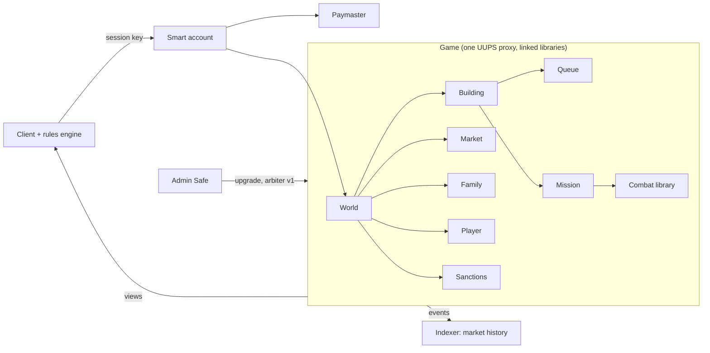

# Blockchain Implementation (EVM)

This file records the decisions needed to implement the target game ([decisions.md](decisions.md))
**fully on-chain** on an EVM network. It sits on top of decisions.md: when a B-xx decision and a
D-xx decision disagree, **this file wins for the on-chain implementation**.

Status: **Adapt** = changes a legacy or target rule so it fits the EVM · **New** = rule that only
exists on-chain · **Open** = not decided yet · **v2** = deliberately out of v1 scope.

## Goals and v1 scope

Why on-chain, all at once:

- **Trustless rules:** the contracts are the server. No operator can cheat, roll back or shut the
  world down (once frozen, B-17).
- **Persistent world:** the game outlives any company or server.
- **Asset ownership:** players own their state. Tokenization is postponed (B-04), but the design
  must not block it.
- **Technical experiment.**

v1 = the complete target game (resources, rooms, research, troops, missions, combat, market,
families, wars, vacation) with **all state and logic on-chain**, playable without the user knowing
which network it runs on. Messaging, chat and moderation are off-chain (B-10).

## Summary

| ID | Topic | Status | Summary |
|----|-------|--------|---------|
| B-01 | Network | New | Arbitrum One public L2, no own chain; code network-agnostic |
| B-02 | Language | New | Solidity; combat as an isolated library; no Stylus |
| B-03 | Integer math | Adapt | Every formula in exact integer arithmetic, no fixed point; 0 deviations from the vectors |
| B-04 | No tokens in v1 | New | Resources, troops and buildings live inside the contracts |
| B-05 | Public state | Adapt | All state is visible to everyone except hidden mission targets (B-22); `spy` / `espionage` unchanged |
| B-06 | Lazy settlement | Adapt | D-08 in two levels: local per building on touch, global mission queue; no keepers |
| B-07 | Global mission order | New | All missions resolve in global arrival order (heap); local events stay per building; an unrevealed hidden mission is parked and re-enters at its reveal |
| B-08 | Chunked settlement | New | Actions process ≤ 10 due missions, else revert `Backlog`; `advance(n)`; one event always fits in a block |
| B-09 | Hard caps | Adapt | Queue, mission and offer limits, configurable |
| B-10 | Off-chain social | Adapt | Messaging, chat, moderation off-chain |
| B-11 | Market | Keep | D-19 as is: no escrow; a defaulter's restitution and penalty are collected on-chain |
| B-12 | Starting coordinate | Keep | Player chooses any free coordinate; no randomness needed |
| B-13 | Multi-accounts and bots | Keep | Everything allowed in v1 |
| B-14 | Sanctions module | New | `suspend(player, until)` by an `arbiter` role |
| B-15 | Accounts | New | Kernel smart account, one passkey per device, passkey directory, recovery, native session keys |
| B-16 | Gas | New | Low sponsored allowance; above it the player pays via credits |
| B-17 | Upgradeability | New | Proxy, no timelock, admin in a Safe; later frozen, one immutable deploy per world |
| B-18 | Events and indexer | New | Reports and notices as events (reports read from the RPC); market history in the indexer; ranking from the loaded world |
| B-19 | Points on-chain | Adapt | D-24 points kept incrementally on-chain |
| B-20 | Optimistic client | New | Client runs the same rules engine and projects results |
| B-21 | Parity tests | New | Foundry against the test vectors with explicit tolerances |
| B-22 | Hidden information | New | Hidden mission **kind and target** (v1), revealed by timelock encryption, with a random cover distance; hidden building state (FHE) only as research |
| B-23 | Arbitration | v2 | Kleros v2 as `arbiter`, under a written rulebook (pushing, bashing, bounties) |
| B-24 | Tokenization | v2 | One ERC-721 per **account** wrapping B-26; no per-building or per-troop tokens |
| B-25 | Premium | New | Longer queues; granted by the admin per player (paid off-chain) or to everyone |
| B-26 | Player identity | New | State keyed by `playerId`; up to 5 controllers (devices, recovery code) that can change; accounts can be given away |
| B-27 | Exact stocks | New | Resources stored in 1/100800 units: per-hour rate ×28 = per-second increment (D-12) |
| B-28 | Alcohol depletion | New | Regime change (D-07) at the whole second `t0 + ⌈stock / net consumption⌉` |
| B-29 | Duration at start | New | Queue items compute their duration when they start (implements D-23) |
| B-30 | Last building | New | A player can abandon any building except the last one |
| B-31 | Families on-chain | New | Three fixed ranks; board and circulars off-chain; ASCII names unique ignoring case; lazy dissolution |

---

## B-01 — Network — New

**Arbitrum One.** No own chain or app-chain. Reasons:

- Sub-cent cost for a typical action (estimated, see [assumptions](#assumptions-to-validate)).
- Kleros v2 runs on Arbitrum One, so the future arbiter (B-23) is a direct contract call, with no
  bridge.
- The RIP-7212 P-256 precompile exists, so passkeys are cheap to verify (B-15).

Gnosis Chain was evaluated (stable gas priced in xDAI). It was rejected because Kleros there needs a
cross-chain bridge and P-256 support is unconfirmed. It stays as plan B.

The contracts must not depend on Arbitrum-specific features (no Stylus, no ArbOS precompiles in game
logic), so the world can be deployed on another EVM network. The **network is invisible to the
player**: no network names, no bridging, no "get ETH" steps in the UI.

## B-02 — Language — New

Solidity. Combat (rounds, targeting, fights, loot) is a **pure library** with no storage access:
it takes the two armies and research levels and returns casualties and loot. This keeps it testable
in isolation and replaceable (e.g. by a Stylus port) if gas measurements ever show combat dominates
cost. Today's estimate is that storage writes, not combat, dominate, and Stylus does not make
storage cheaper.

## B-03 — Integer math — Adapt

The EVM has no floating point. Formulas that use `sqrt`, fractional powers or PHP `round()`
([05-formulas.md](05-formulas.md)):

| Formula | Non-integer operation | On-chain |
|---------|-----------------------|----------|
| Troop effective stats | `sqrt(levels)`, `floor`, `round` | **Exact** integer formula (below) |
| Loss ratio | division, rounded to 3 decimals (D-15) | **Exact** integer formula (below) |
| Combat power | modifiers with one decimal, honor % | **Exact**: modifiers ×10, integer % |
| Honor % | interpolation, `round` | **Exact** (the interpolated value is a multiple of 1/5, never a tie) |
| Loot (D-06) | proportional split | **Exact** (integer by design) |
| Distance | `sqrt(dx² + dy²)`, `round` | **Exact**: `s = isqrt(N)`, plus one if `N ≥ s² + s + 1` |
| Travel time | `(…)^0.2`, `round` | **Exact** rational root (below) |
| Salary | `distance^0.8`, `floor` | **Exact** rational root (below) |
| Room / research time | division, `round` (research: twice) | **Exact**: `round(n/d) = (2n + d) / 2d` |
| Troop training time | `duration / level × quantity` (float, truncated by legacy) | **Exact**: `⌊duration × quantity / level⌋` |
| Production | `round(f × ((L+1)/2)²)`; D-07 partial flows `/7`, `/4` | **Exact**: rates kept ×28 (lcm of the converters' consumption per unit) |
| Points | per-level values with up to 2 decimals | **Exact**: centipoints (×100) |

**Exact formulas** (implemented in `contracts/src/combat/`, measured in the combat spike):

- Stats: `floor((1 + √L/10) × base) = base + ⌊isqrt(base² × L) / 10⌋` and
  `round((1 + √L/10) × base) = base + ⌊(isqrt(base² × L) + 5) / 10⌋`. Both identities are exact for
  integers, so no precision is lost.
- Power: `units × (attack + defense) × modifier×10 × pct`, an integer. Loss ratios only depend on
  the ratio of the two sides' power, so the common scale (×1000 vs legacy) does not matter.
- Loss ratios, with `A`, `D` the two sides' power: wipe branches as legacy; otherwise, if `A > D`,
  `PPA = (21D − A) / (20(D + 2A))` and `PPD = A / (A + 2D)`; else `PPA = D / (D + 2A)` and
  `PPD = (21A − D) / (20(A + 2D))`. This is the legacy formula simplified to one fraction. Rounded
  half up to thousandths: `(2000 × num + den) / (2 × den)`.

- **Rational powers:** `⌊s × (a/b)^(p/q)⌋` is the largest `k` with `kᵠ·bᵖ ≤ sᵠ·aᵖ`, found with an
  integer root and an exact check. Decimal constants in `game_config.yaml` are read as exact
  fractions (`3.3479 = 33479/10000`, `0.2 = 1/5`, `0.8 = 4/5`).
  - Travel time `round(3600·(d·3.3479/v)^(1/5))`: `⌊2x⌋` with `s = 7200`, then `(⌊2x⌋ + 1) / 2`.
  - Salary `⌊d^(4/5) × S / 2512⌋`: `⌊S·d^(4/5)⌋` with `s = S`, then integer division by 2512.
  - Solidity: `S` up to ~10¹⁰ keeps `S⁵·d⁴` inside `uint256`; larger salaries need a 512-bit check.
- Rounding is half away from zero, as PHP. All rounded values here are non-negative.
- Every vector that does not match exactly is listed here with its tolerance (`exact` or `±1`), and
  the on-chain implementation becomes the reference for that value (B-21).

Reference implementation: `packages/rules` (TypeScript, `bigint`). Solidity so far: combat, stats,
loot, honor (`contracts/src/combat/`); the other formulas move to Solidity with their modules.

**Deviation list: none.** Every vector matches exactly, in both TypeScript and Solidity where both
exist: 309 target combat vectors (every round and troop type), `troop_stats`, `loot`, `honor`,
`building_upgrade` (180), `research_upgrade` (192), `troop_training` (84), `storage`,
`distance_mission` (10 + 200 random, with travel time and salary) and the 22 `production` cases
where legacy and D-07 agree. Legacy PHP uses doubles, so a value exactly on a rounding tie could
still differ; none appears in the vectors.

## B-04 — No tokens in v1 — New

Resources, troops, research and buildings are **contract state**, not ERC-20 or NFT. They cannot be
transferred except through game mechanics (transport, market, loot). Tokenization is B-24.

## B-05 — Public state — Adapt

All on-chain state is readable by anyone: room levels, resources, troops, queues, missions in
transit. Consequences:

- The espionage side effect of attacks ([06-combat.md](06-combat.md#espionage)) gives no new
  information, since anyone can read the defender's rooms and resources.
- `spy` and `espionage` are **kept unchanged**. `espionage` still matters: it boosts the attack and
  defense of `spy` and `mercenary`. The report keeps the legacy spy rule, even though the information
  is public.

Exception: the kind and target of a hidden mission stay secret until it arrives (B-22).

## B-06 — Lazy settlement — Adapt

D-08 says the state at time `t` does not depend on when or how often it is computed. On-chain this
is implemented in two levels:

- **Local, per building, on touch.** Each building stores `lastUpdate`. Any transaction that reads or
  writes a building first brings it up to the needed time, processing its **own** events in order:
  room queue items finishing and starting (D-11), research items if it is the building where its
  owner researches, troop batches, and the alcohol regime change (B-28). Between events, stocks are
  integrated exactly (B-27). This is bounded by the queue sizes, so it always fits in one transaction.
- **Global, for missions (B-07).** Missions are the only events that connect buildings (attacks,
  returns with loot, transports, occupations that change the building count used by honor).
- **No keepers are required for correctness.** If nobody touches a building, its events wait. The
  result is the same whenever they are processed. Keepers (or the client) may advance state for
  convenience only. Readers that need the current value (the ranking, B-18) settle a copy of the
  state off-chain with the simulator (B-20) instead of touching the building.

## B-07 — Global mission order — New

Every mission in the world resolves in **global arrival order**, ties broken by creation order
(D-08), from an on-chain priority queue (heap) keyed by `(arrival, sequence)`.

- Before any action, missions with arrival ≤ now are processed, up to `maxEvents` per transaction
  (B-08). Each one first settles its target building **locally** up to the arrival time, then
  resolves (combat, delivery, occupation, return). If a backlog remains, the action reverts and the
  client calls `advance` until the queue is caught up.
- A due hidden mission that nobody revealed yet never stops the queue: it is **parked** out of it
  and re-enters, as public, with its reveal time as arrival (B-22).
- **Same-second order.** A building's own events (room, research, training) that finish at the
  arrival second are ordered against the mission by creation (`seq`, D-08): those created before
  the mission was created resolve before it, those created after resolve after it. A vacation that
  starts in the same second as a hidden send is ordered the same way (B-22).
- Why global and not per target: a mission's return depends on a battle in another building, and
  honor depends on occupations still in flight. With per-target order, settling one building would
  need a recursive resolution across buildings and players, with a work stack stored on-chain and
  unpredictable gas. The global order makes every step local and bounded. Construction, research and
  training are **not** in the global queue.
- Cost: the queue adds ~50–150k gas per mission (insert + pop) against ~1.2M for a combat. The total
  work is the same in any design; what changes is who pays: whoever acts first after a burst of
  arrivals processes them. The paymaster (B-16) and our keeper cover it.
- Possible later optimization: let a player act without draining the queue when no pending mission
  involves them.

## B-08 — Chunked settlement — New

Local settlement is bounded by the queue sizes, so it always fits in a transaction. The global
mission queue (B-07) is not: after a burst of arrivals there may be more due missions than one
transaction can process. So:

- Every player action first processes due missions, at most **`MAX_MISSIONS_PER_TX` = 4**. If due
  missions remain, the action **reverts** with `Backlog`.
- `advance(n)` is public (anyone, no ownership): it processes up to `n` due missions and never
  reverts on a remaining backlog. The client (or our keeper) calls it, then retries the action.
- **Gas cap:** a due mission is processed only while at least `MISSION_GAS_RESERVE` (7M, the
  invariant below) gas is left; otherwise the action (or `advance`) reverts with `Backlog` instead
  of running out of gas midway. It never succeeds having skipped a due mission for lack of gas, so a
  gas estimate covers every mission it must process. This matters because an action's cost depends
  on when it lands: missions may come due between the gas estimate and inclusion. On `Backlog` the
  client retries with `advance(MAX_MISSIONS_PER_TX)` in front, in the same operation; if that
  fails too, the client and the keeper fall back to `advance(1)` in separate operations until the
  queue is caught up. The simulator has no gas, so it never stops early; with enough gas both
  agree. Side effect: while a mission is due, an action's estimated gas limit includes the 7M
  reserve (only the limit; ERC-4337 charges 10% of the unused part).
- **Invariant:** one single mission always fits in a transaction with room to spare. The reserve
  stays above the heaviest mission measured: a battle alone costs **~1.37M** in the worst case
  found (`forge test --match-contract BattleGas -vv`), but a mission also settles up to four
  buildings (origin, target and both research buildings): with full premium queues an attack
  costs **~4–6.4M** (`forge test --match-contract MissionGas -vv`), so the reserve is 7M and the
  batch 4 (4 × 7M fits Arbitrum's 32M transaction limit). 7M is provisional until a
  reachable-state measurement (a long trip with queue items that finish during it) confirms it.

## B-09 — Hard caps — Adapt

Legacy has unlimited troop queues and open offers ([05-formulas.md](05-formulas.md#queues),
[09-social.md](09-social.md#market)). On-chain every loop must be bounded. The starting values below
are to be tuned with gas measurements and live in the `onchain` section of
[data/game_config.yaml](data/game_config.yaml):

| Limit | Start value | Why |
|-------|-------------|-----|
| Troop batches queued per building (`boot_camp` / `security`) | 1, or 5 with premium (B-25) | Bounded settle |
| Missions in flight per player (outbound and returning) | 20 | Bounded state; no cheap spam of the global queue |
| Open market offers per player | 10 | Bounded state |

There is no limit on missions **to** one building: with the global mission queue (B-07) each mission
is processed on its own, so many attacks on one victim do not make any single transaction heavier
(as in legacy, a building can receive many attacks). Room and research queue limits from legacy are
kept. The number of buildings per player stays
unlimited: each building is settled separately, so it does not affect gas per transaction.

## B-10 — Off-chain social — Adapt

Off-chain: **messaging, chat and moderation** ([09-social.md](09-social.md#messaging)), with a
separate service or a messaging protocol (e.g. XMTP), identified by account address.

On-chain because they affect rules: **families, wars, vacation and market.**

On-chain moderation does not exist: no one can ban an account. The only sanction is B-14.

## B-11 — Market — Keep

D-19 as is: offers at fixed rates, delivery by ordinary transport missions, **partial deliveries**
from any number of buildings, **10-day window** after acceptance, **no escrow**. Each shipment is
credited on arrival; a party that does not deliver owes **restitution plus a penalty**, which the
contract computes and collects (D-19, [Default](decisions.md#default)).

Why no escrow: one payment often needs several transports from different buildings (cargo depends on
the troops sent, [07-missions.md](07-missions.md#salary-and-cargo)), so a trade cannot be settled in
one step, and an escrow that holds partial deliveries would work as an unlootable vault. Restitution
starts only when the window closes, so until then nothing is locked or safe from loot.

Why not Kleros (as first planned): every fact of a default (`delivered`, `paid`, the window) is
on-chain, so the contract can decide it with rules announced up front, and a jury would cost more
than most trades. Kleros (B-23) keeps only what the contract cannot see.

Counterparty risk has two answers:

- **Reputation:** every offer, acceptance, delivery, claim and debt emits an event. The indexer
  (B-18) shows each player's trade history (completed, defaulted, debts still open).
- **Restitution:** collected on-chain, no arbiter.

On-chain details:

- `offerTrade(buyer, sold, quantity, price)`: the price must equal one of the fixed rates exactly,
  compared with integers over the common denominator (`quantity / rate[sold] = Σ price[r] / rate[r]`).
  The converted resource (alcohol) is neither sold nor paid, and a resource is never traded for itself.
  The trade stores the index of the rate it matched; a price that matches more than one rate is
  rejected (`InvalidOffer`), so the stored rate is never ambiguous. `quantity` and every
  `price[r]` must fit in 64 bits (`InvalidOffer`).
- `acceptTrade` checks the seller again: active (not on vacation nor suspended, B-14) and without
  a registered debt; otherwise `InvalidTrade`.
- A seller has at most 10 open trades (pending, or accepted inside the window and not complete, B-09).
- `sendMission(…, trade)`: a transport names the trade it delivers for (D-19). The target must
  belong to the counterparty when it leaves (after the window: to the creditor), `InvalidTrade`
  otherwise. At arrival the cargo **counts in full** for the trade, per resource and up to what
  remains, whatever happened to the building meanwhile (D-26); what fits is credited and the rest
  is lost (D-10):
  - inside the window: seller → buyer, the sold resource adds to `delivered`; buyer → seller, each
    price resource adds to `paid`;
  - after the window: debtor → creditor, each owed resource adds to `returned`.

  The rest of the cargo is a plain transport.
- The debt is a pure function of the trade: `owed` (D-19, penalty included) from `delivered`,
  `paid`, the rate and `default_penalty_percent`, minus `returned`. No state changes when the
  window closes.
- `claimTrade(trade, fromBuilding, toBuilding, amount[RESOURCES])`: creditor only, after the
  window. `fromBuilding` belongs to the debtor and `toBuilding` to the creditor; both are settled
  first (B-06). Each `amount[r]` must be ≤ what remains of `owed[r]`, ≤ the stock of `fromBuilding`
  and ≤ the free capacity of `toBuilding`, alcohol and resources not owed are 0, and at least one
  is > 0; otherwise it reverts. The resources move directly (no mission) and add to `returned`.
  Works whether the debtor is active, suspended or on vacation.
- **Registration:** `registerDebt(trade)` (creditor only, after the window, idempotent: it moves
  nothing and emits `DebtRegistered` once) or the first claim sets `Trade.registered` and
  increments the debtor's `Player.debts` and `owes[debtor][creditor]`. When `returned` reaches
  `owed`, both decrement. Every check below is O(1).
- **Restrictions** while `Player.debts > 0`: `offerTrade` and `acceptTrade` revert `InDebt`;
  `startVacation` reverts; `sendMission` of a transport to a building not owned by the sender or
  by one of its creditors reverts `InDebt`; a transport that names a trade the debtor owes on is
  always allowed to that trade's creditor, registered or not. Hidden missions (B-22) cannot be checked at send, so at
  arrival a transport (hidden or not) from a player with debts to such a building **bounces**:
  it turns back with its troops and cargo.
- **Vacation lock:** `acceptTrade` sets `tradeLockUntil` of both parties to the latest window end;
  `startVacation` reverts while `now ≤ tradeLockUntil`. A trade completed early still holds the
  lock until its window closes (one timestamp instead of a list of trades per buyer).
- Events: `TradeSettled` (also after the window, with `returned`), `TradeClaimed(trade, amount)`,
  `DebtRegistered(trade, debtor, creditor)`, `DebtPaid(trade)`.

## B-12 — Starting coordinate — Keep

The player picks any free coordinate, as in legacy ([08-progression.md](08-progression.md#account-lifecycle)).
Being near the centre makes attacks and transports faster and cheaper, so a land rush at launch is
expected and accepted. The map size is a per-world parameter.

There is no "random free coordinate" option, so combat and placement need **no on-chain
randomness** (no VRF).

## B-13 — Multi-accounts and bots — Keep

Everything is allowed in v1:

- The contracts are a public API, and automation is legitimate.
- Multiple accounts are not prevented, even though each new account gets the `new_player` starting
  resources ([game_config.yaml](data/game_config.yaml)) and can send them to another account.

A written rulebook (pushing, bashing and similar abuse) and arbitration come later (B-23).

## B-14 — Sanctions module — New

A `Sanctions` module exposes `suspend(player, until)` (`until` = 0 lifts it), callable only by the
`arbiter` role. In v1 the arbiter is the admin Safe (B-17); later it is a Kleros arbitrable contract
(B-23).

A suspended player:

- **cannot act:** build, research, train, send missions, trade, change family;
- **keeps producing**, and queues and missions already running complete;
- **can be attacked.** Otherwise suspension would work as free vacation, which is a reward.
- cannot transfer the account (B-26).

The lock is one check shared by every player action, also used for vacation (D-18): a player on
vacation or suspended can only end the vacation. In v1 `suspend(player, until)` is `onlyOwner`
(`until` = 0 lifts it).

## B-15 — Accounts — New

- **Smart account** per player: **Kernel** (ZeroDev's open-source ERC-4337 account, EntryPoint
  0.7), used directly without ZeroDev's services. It is a controller of the player (B-26).
- **Passkeys as signers**, one per device. Synced passkeys (iCloud, Google) cover one ecosystem.
  Each passkey owns **its own** Kernel account (Kernel's WebAuthn validator holds one key per
  account), so a device from another ecosystem gets a new passkey and a new account, which an
  existing device adds as **another controller** of the player (B-26). The game, not the wallet,
  knows which accounts manage a player, so the account type can change later (e.g. a Safe) by
  adding the new account and removing the old one.
- **Passkey directory** (`PasskeyDirectory`, ownerless, not upgradeable): WebAuthn returns the
  public key only at creation, so the account publishes `credentialId → (P-256 key, account)` when
  it is created. Another device with the synced passkey looks the key up, keeps only the entry whose
  key verifies its sign-in assertion and whose account that key derives, and rebuilds the account
  without a server. Entries are uncapped and read in pages, so a squatter cannot block a credential.
- **Recovery code:** the client draws a random key, shows it once for the player to keep, and adds
  the simple 4337 account it controls (as for sessions) as another controller, flagged as a recovery
  code (B-26) so every device lists it as one. On a new device: new passkey, then the code adds its
  account as a controller and may schedule the lost one's removal. A used code is still a
  controller: the client suggests replacing it. An email-based method may come later (it needs a
  service).
- **Session keys, native to the game:** the controller calls `authorizeSession(session, until)` to
  invite a per-device address (a simple 4337 account held by a browser key) to play for it, at
  most `onchain.max_session_seconds` (30 days). The session binds only when that address accepts
  (`acceptSession(player)`, sent by the session address itself), so nobody binds an address it
  does not hold; the invitation lasts until `until`. Renewing is inviting again, accepted again in
  the session's next operation; `revokeSession` ends it.
  A session does every game action, under the same vacation and suspension locks, but never manages
  the account: it cannot authorize or revoke sessions, transfer the player, or register a player of
  its own (`NotController`, `AlreadyRegistered`). An address is a controller or a live session,
  never both. Managing sessions works while the player is locked. Each player has a
  `sessionEpoch`, bumped by `transferPlayer`, so the previous owner's sessions die without being
  enumerated. The passkey signs only to create the account, open or renew a session and manage
  devices.
- **Client flows** (`apps/web/src/account/`): *create* = new passkey, then one operation from the
  counterfactual account that publishes it in the directory, registers the player and invites
  this device's session; the session accepts in front of its first action. *Sign in* = a WebAuthn
  assertion on a random challenge, then the directory check above, then inviting this device's
  session. Every game action goes out through the session with no prompt; when the session has
  lapsed, the action first renews it (one passkey prompt) and accepts the invitation in front of
  the action. The session key lives in browser storage: it can only play, expires and is revocable.
  *Add a device* = the new device makes its passkey and shows a link (and QR) with its account's
  address; a device already in the account opens it and invites it (`inviteController`, one
  prompt); the new device accepts from its own account (`acceptController`, one prompt, publishing
  its passkey in the same operation).
  *Recovery code* = 120 random bits shown as six groups of four base32 characters; the key is
  `keccak256("vendetta recovery v1" ‖ bits)` and its simple account becomes a controller (one
  prompt). *Recover* = new passkey, then the code's account invites it (no prompt), then the new
  account accepts, publishes its passkey and invites the session (one prompt); the device remembers
  which code it used and suggests a new one. An account that joined without publishing yet publishes
  with its first session renewal. *Remove a device* schedules the removal (B-26) and later executes
  it; both steps kill every session, so each re-authorizes this device's session in the same
  operation.
  Kernel v3.1 (the last version with a WebAuthn validator in permissionless.js) and the
  SimpleAccount factory for the session, both already deployed on Arbitrum One. permissionless.js
  0.4 always signs with `usePrecompiled = false`, so the passkey signature is checked by the
  Solidity P-256 verifier instead of RIP-7212: passkey operations cost ~0.3M gas more, but they are
  rare (create, renew, manage).
- Game actions vary in cost with the time they run (lazy settlement, due missions processed on the
  way: B-06, B-07), so the client gives the bundler's `callGasLimit` estimate 50% + 100k of
  headroom before the paymaster signs.
- **Local testing** (`pnpm dev:aa`, `e2e:aa`): a plain anvil with the account contracts copied
  from Arbitrum One at their addresses (`apps/web/scripts/aa-contracts.json`), Alto and Pimlico's
  mock paymaster; Playwright drives a virtual WebAuthn authenticator. No fork: public RPCs drop old
  state within minutes.

## B-16 — Gas — New

- A game **paymaster** (ERC-4337 / EIP-7702) sponsors a **low** allowance per account and day.
  Bundler and paymaster: **Pimlico** (paid plan), with a sponsorship policy that sets the limits;
  no relayer of our own.
- Above it the player pays. The payment path is **credits bought by card** (on-ramp into the smart
  account, or a paymaster that charges credits), never "get ETH on Arbitrum".
- Credits pay for gas only. **Premium** is separate (B-25).
- Network selection in the client: `VITE_NETWORK` (`local` with anvil's development accounts, or
  `arbitrum` for Arbitrum One), Pimlico's key in `VITE_PIMLICO_API_KEY` and its sponsorship policy in
  `VITE_PIMLICO_POLICY_ID`. The key ships in the static bundle, so the sponsorship policy (and
  Pimlico's allowed origins) is what bounds spending, not the key.
- Deploy and operation (Pimlico setup, limits, `.env`, `pnpm deploy:arbitrum`):
  [../deploy-arbitrum.md](../deploy-arbitrum.md).

## B-17 — Upgradeability — New

- **v1:** contracts behind upgradeable proxies, **with no timelock**, so bugs can be fixed quickly
  while the game matures.
- **Admin = a Safe multisig** (e.g. 2-of-3), never a single key.
- **Later:** the contracts are frozen, then each world is an **immutable deploy**. A ruleset
  (`vendetta.yaml`, `space4k.yaml`) maps to one world.

Until the freeze, the "trustless rules" goal (Goals) is only partly met. This is accepted.

## B-18 — Events and indexer — New

- Battle reports, notices (delivery, occupation, trade, family) and history are **events** (logs),
  not storage.
- The `Battle` event carries the **inputs and totals**: the attacking and defending player, both armies, both players' research and
  honor percentage, survivors and loot. Combat is deterministic, so the client recomputes the exact
  rounds (deaths per round and troop type, 06-combat.md#battle-report) with `packages/rules`. This
  costs less gas than logging every round.
- **Reports are read straight from the RPC**, only the recent ones: public RPCs cap the block range of
  a log query (Arbitrum One's: 10M blocks, about a month), and the client asks for the last 5M blocks.
  Losing older reports is accepted; they are not worth an index.
- An **indexer** keeps the **market history** (B-11): every offer, acceptance, delivery, claim and
  debt, cancelled offers included (the contract deletes those). It is a **Goldsky Subgraph** (The
  Graph format, `packages/indexer`), queried over GraphQL. Because the format is The Graph's and the
  events are on-chain, anyone can deploy the same subgraph elsewhere. Locally it runs on a
  graph-node in Docker.
- The **ranking** (08-progression.md#ranking) is computed by the client from the world it already
  loads through the views (B-20), not by the indexer: it sorts the players, and the families by the
  sum of their members, on the points of the world projected to the current time. The projection
  settles every building (B-06), so the ranking shows current points even for a player who has not
  acted since its queues finished, with no keeper and no transaction. Sorting on-chain would be too
  expensive; sorting a world the client holds anyway costs nothing.

## B-19 — Points on-chain — Adapt

Points (D-24) are kept on-chain because they drive rules (honor, [06-combat.md](06-combat.md#honor)).
They are updated **incrementally** on every change that affects them, and must always equal the value
derived from state. A view function recomputes them from scratch, used by tests to check this
invariant. Points emit no event: the stored value is read through `getPlayer` / `getBuilding`, and
lazy settlement (B-06) leaves it behind finished queues until a building is touched, so the ranking
(B-18) reads the projected value instead.

## B-20 — Optimistic client — New

The client runs **the same rules engine** as the contracts, compiled from the same spec and checked
against the same vectors. It shows the projected result of an action immediately and reconciles
when the transaction confirms. This is possible because the simulation is deterministic (D-08) and
has no randomness (B-12).

## B-21 — Parity tests — New

- Contracts are tested with **Foundry** against [data/test_vectors.yaml](data/test_vectors.yaml) and
  [data/test_vectors_target.yaml](data/test_vectors_target.yaml), converted to JSON.
- Each vector passes exactly, or is listed in B-03 with its tolerance.
- The client rules engine (B-20) runs the same vectors.

## B-22 — Hidden information — New

Constraints:

- **The defender is usually offline.** If the defender's state is hidden, only something that knows
  it can compute the battle when an attack arrives.
- **Building troops are public** (B-05). When a mission leaves, the drop in the origin building's
  troops shows exactly what it carries. So hiding a mission's **composition** hides nothing unless
  building state is hidden too.

Options considered:

| Option | Hides | Notes |
|--------|-------|-------|
| **Hidden target + timelock encryption** | Where a mission goes | **Chosen, in v1.** Details below. |
| **Private keeper** (operator holds the secrets) | Where a mission goes | Rejected: the operator sees every target first, and a leaked key leaks them all. |
| **Shutter threshold encryption** (keyper committee, time or event triggers) | Where a mission goes; with ZK, building state until attacked | Encrypt now, reveal later: the contract never computes on ciphertext. Alternative to drand tlock for the hidden target, needed only for event triggers (e.g. "when the previous mission resolves"). Hiding building state would take a commitment plus a ZK proof per action, with the state encrypted to a trigger "an attack arrives here", which solves the offline defender. Trust: a threshold of keypers can decrypt early. Event triggers still in development; Arbitrum One support unconfirmed. **Research only.** |
| **Client-side ZK** (Noir, Circom) | Own actions (e.g. "I can afford this") | Verifier ~250–400k gas. Does not solve battles against an offline defender. |
| **FHE** (Zama fhEVM, Fhenix CoFHE) | Full state | Fully homomorphic encryption: the contract computes on encrypted troops and resources and only the report is decrypted. The only fit for hiding an offline defender's state. Costly, combat (divisions, comparisons) is heavy on encrypted values, and depends on a third-party coprocessor and decryption network. **Research only.** |
| **TEE / confidential EVM** (Oasis Sapphire) | Full state | Another network; trust in enclave hardware. |
| **ZK for scaling** (RISC Zero, SP1) | Nothing | Off-chain simulation with an on-chain proof. Fallback if full on-chain proves too expensive. |

**Hidden target (v1).** Brought forward from v2: with public targets, an automated defender
dodges every attack precisely, and travel time stops meaning anything. Measured in the B-22 spike:
tlock works from the browser and Node against drand quicknet (~0.5 s to encrypt, ~1 s to decrypt,
394-byte ciphertext, 60 kB gzip loaded on demand); EIP-2537 is live on Arbitrum One but its pairing
precompile only returns a boolean, so decrypting tlock on-chain is not practical.

- **Send.** `sendHiddenMission(building, commit, cover, troops, resources, ciphertext)`, with
  `commit = keccak256(abi.encode(owner, kind, city, neighborhood, slot, salt))`: the kind is
  hidden too. Everyone sees that a mission left, its troops, its cargo and its arrival time; nobody
  sees its kind or target until it is revealed. The client encrypts `(kind, target, salt)` with
  **drand timelock encryption** (tlock) for the drand round at the arrival time; the ciphertext is
  only emitted in `HiddenMissionSent`, never stored.
- **Cover distance.** The contract cannot compute the travel time from a target it does not know,
  so the sender declares a **cover** distance (grid units) ≥ the real distance. Duration and salary
  are computed on `cover` with the usual formulas. Duration and salary reveal the exact distance
  (the spike measured a median of **1** candidate target with 50–200 buildings), so the client
  always picks a random cover: `cover = d + U(0, max(⌈d/2⌉, 20))`, which leaves ≥ 13 candidates in
  9 of 10 sends with 200 buildings, for ~5% more travel time and ~20% more salary. The salary
  difference is not refunded. `1 ≤ cover ≤` the distance from the origin to the farthest map
  corner, the longest trip that building can already make with a real target, so hiding never
  allows a longer trip (fleet save) than today.
- **Reveal.** `reveal(id, kind, target, salt)`: anyone, until the grace ends (before the drand round
  only the sender knows the plaintext); past `arrival + hidden_reveal_grace_seconds` it does
  nothing. The contract checks the hash, that the kind and coordinate are valid and not the
  origin, and that `distance(origin, target) ≤ cover`; otherwise it reverts. Revealing a mission
  that is no longer hidden does nothing, so clients and the keeper can race. Reveal drains the
  queue like any action (B-07), so every due mission ahead of it is processed or parked first;
  with a backlog it reverts `Backlog` and the client advances first. A mission revealed before it
  arrives resolves at its arrival like a public one; one revealed after its arrival (**parked**,
  below) re-enters the queue with the reveal time as its arrival and a fresh `seq`, so it
  resolves against the target's state at the second of the reveal, with the same-second order of
  B-07 applied to that second.
- **Parking.** The queue never waits for a reveal. When its head is a due hidden mission nobody
  revealed yet, the queue takes it out to the parked list (`parkedMissions`, in arrival order: a
  doubly linked list on-chain, so a reveal checks its predecessor only) and goes on with the
  next mission; nothing stalls: construction, research, training, trades and everyone's missions
  carry on. A parked mission keeps its troops and cargo and leaves the list by a reveal, a recall
  or a forfeit. Clients reveal their own missions at the arrival when they are online, and the
  keeper reveals every parked mission as soon as its round is out (others' plaintexts come from
  decrypting the ciphertext). The defender cannot dodge more than with a public target: what it
  knows at the arrival (origin, cover disk, troops, arrival time) it already knew when the mission
  left.
- **Forfeit.** Past `arrival + hidden_reveal_grace_seconds` (60 s), anyone calls `forfeit(id)` on
  a hidden mission nobody revealed: it turns back from that moment with all its troops and cargo
  (a recall by its owner does the same at any time). The keeper does
  it; the sender has every reason to do it first. A ciphertext that does not decrypt or does not
  match the commitment is forfeitable after the grace like any other; there is no bond and no
  garbage report. While parked it takes part in the order window below: that is all it can do
  to others.
  The grace stays short because it bounds how long a sender who is online can pick the moment of
  its own reveal (~10 s in practice, until the keeper reveals), and because without it an
  unrevealed mission would be a permanent fleet save whose attack lands whenever its owner chooses.
- **Order.** Reveals go in arrival order for `hidden_order_window_seconds` (15 s): a due hidden
  mission can be revealed only once every parked mission that arrived before it, by
  `(arrival, seq)`, is past its window; otherwise `OutOfOrder`. The keeper reveals each mission
  as soon as its round is out (8–12 s after the arrival) and the sender's client at the arrival,
  so hidden missions resolve in the order they arrived; one nobody can reveal (garbage) holds the
  ones behind it for the window at most, then they go on and may overtake it, which is all a
  garbage ciphertext can do to others. The window must exceed the keeper's latency, so it moves
  with the 10 s round margin. Public missions (returns, trade transports) still resolve at their
  arrival, so one can land before a parked hidden mission that arrived earlier: accepted, as the
  legacy cron resolved at minute granularity.
- **Return cooldown.** A building that just took returning troops in cannot send a mission for
  `return_cooldown_seconds` (30 s, [game_config.yaml](data/game_config.yaml)): `TroopsResting`.
  It keeps the legacy interception alive: an attack timed to land right after the enemy's troops
  come home catches them. Without it the defender's own send in the seconds between the arrival
  and the reveal of the parked attack would park the attack and let the troops leave again; the
  legacy cron resolved the return and the attack in the same minute. The cooldown has to outlast
  the attack's reveal: `arrival gap + hidden_order_window + reveal latency`, with the gap the
  ~3 s an attacker can aim at after the return, the window because a parked mission ahead (a
  garbage one, even the defender's own) holds the attack's reveal until `attack arrival +
  window` at the latest, and ~5 s for the keeper's tick and the inclusion once the reveal is
  allowed. `30 > 3 + 15 + 5` leaves slack. An operating assumption, not a guarantee: no finite
  cooldown covers a keeper outage or a backlog that delays the reveal past it. The sender's own
  client reveals at the arrival, so it may land anywhere in the window, even a little before
  the return and be revealed right after it. Not legacy.
- **Arrival rules** are the usual ones (07-missions.md), plus D-18 checked at arrival: a hidden
  mission bounces if the target's owner was on vacation when it was sent (a vacation started later
  does not protect, a vacation started in the same second counts by creation order, B-07). A
  transport from a player in debt to anyone but its own buildings and its creditors also bounces
  (B-11).
- `sendMission` stays public; the client uses it only for transports bound to a trade (D-19), whose
  counterparty is public anyway. Recall works the same on hidden missions.
- **Timelock per network.** On Arbitrum One, tlock for the quicknet round at `arrival + 10 s`
  (drand's `roundAt` floors to the round scheduled at most 10 s after the arrival, so the
  ciphertext opens 8–10 s after it). Inclusion latency must not push the real arrival past that
  round: `sendHiddenMission` takes a `deadline` and reverts `TooLate` when the arrival computed at
  inclusion would be later; the client sets it to the round's time minus one second and encrypts
  again on that error. On local chains the plaintext travels as is ("plain"): anvil's clock
  jumps (time travel) and drand's does not.
- **Measured:** `sendHiddenMission` ~400k gas with a 400-byte ciphertext, `reveal` ~16k before
  the arrival and ~48k on a parked mission (it re-enters the queue; the order check reads its
  predecessor only, whatever the length of the parked list), plus whatever its drain processes;
  parking ~30k inside the drain that does it (`forge test --match-contract HiddenMissions -vv`).
- **Accepted leaks:** the cover ring; the cargo (a mission carrying resources is a transport); the
  troops (an occupation needs its occupation troop).

## B-23 — Arbitration — v2

A written rulebook for the abuse the contracts cannot see. Anyone can open a case on **Kleros v2**
(Arbitrum One, B-01) by paying the arbitration cost. The ruling calls B-14 (`suspend` for X days).
Violations in mind:

- **Pushing:** moving resources to one's own or an allied account abusively: new accounts created
  for their starting resources, being looted on purpose by one's own account, emptying the
  buildings to another account before a trade window closes to dodge restitution (B-11).
- **Bashing:** attacking the same player repeatedly beyond a limit the rulebook sets.
- **Unpaid bounties:** a player offers a reward for attacking someone and does not pay it. There
  is no bounty mechanism yet.

Not delivering an accepted market trade is not here: the contract collects restitution (B-11).
Open: the exact rules, the list of sanctions, the court and the cost per case.

## B-24 — Tokenization — v2

The only token with value is the **account**: one ERC-721 per player, wrapping B-26. Transferring
the NFT transfers the account (`transferPlayer`), with the same rules. Buildings, troops and
resources are **not** tokenized individually (B-04 stays).

## B-25 — Premium — New

The premium module in the legacy code is an empty stub. In the original game premium unlocked
longer queues. Target:

| Queue | Without premium | With premium |
|-------|-----------------|--------------|
| Rooms, per building | 1 | 6 (legacy value, [05-formulas.md](05-formulas.md#queues)) |
| Research, per player | 1 | 6 (legacy value) |
| Troop batches, per training room | 1 | 5 (B-09) |

Values live in the `premium` section of [data/game_config.yaml](data/game_config.yaml). The legacy
`queues` values become the premium limits.

- **Purchase:** off-chain (card, credits). The contract holds no funds: the admin (Safe) records it
  with `grantPremium(player, until)`.
- **State:** `premiumUntil` per player. `isPremium(p) = premiumUntil[p] > now || globalPremiumUntil > now`.
- **Global premium:** the admin (Safe, B-17) can call `setGlobalPremium(until)` to give premium to
  every player for a while (events, launch, compensation).
- **Expiry** (own or global): items already queued finish normally; new items can only be queued
  while the queue is below the limit without premium.

## B-26 — Player identity — New

All game state (buildings, research, points, family, missions, queues, market trades, premium,
sanctions) is keyed by a **`playerId`**, never by an address. Each player has **1 to
`onchain.max_controllers_per_player` (5) controllers**: its devices' accounts and recovery codes
(B-15). They are all equal: any of them manages the account and plays. The contract records which
controllers are recovery codes, so every device labels them right.

- `inviteController(address, recovery)`: by a controller (never a session key), for an address
  that controls no player and is no live session (`ControllerTaken`). The address becomes a
  controller only when it accepts itself (`acceptController(player)`, within the cap,
  `TooManyControllers`): nobody is bound to an account without its own call. An invitation lasts
  `onchain.invite_ttl_seconds` (7 days), dies with the player's `sessionEpoch`, and any controller
  drops it with `cancelInvite(address)`.
- `removeController(address)`: by a controller. Removing **itself** is immediate, never the last one
  (`LastController`). Removing **another** controller takes two steps: the first call schedules it
  for `now + onchain.controller_removal_delay_seconds` (3 days), bumps `sessionEpoch` (every session
  dies now, a lost device's included; the remaining devices authorize theirs again) and emits
  `ControllerRemovalScheduled`; once due, the same call by any controller executes it
  (`ControllerRemoved`, `sessionEpoch` bumped again). Before that it reverts `RemovalPending`.
  Nothing is lazy: a due removal stays pending until someone executes it. The targeted controller
  keeps every right meanwhile, cancelling included.
- `cancelRemoval(address)`: any controller drops a scheduled removal (`NoRemoval` if there is none).
- All of these work while locked (vacation, suspension): the player stays the same, so no sanction
  is escaped.
- **Residual risk.** A thief holding an unlocked device and the owner can cancel each other's
  removal forever: a stalemate, but neither takes the account alone, since nothing executes while
  the other side cancels. The owner cuts the thief's play at once with `revokeSession` (any
  controller revokes any session of the player) and wipes the device remotely.
- `transferPlayer(newController)` gives the whole account to someone else, in two steps: a
  controller schedules it (`PlayerTransferScheduled`; the target must be free), and once due the
  **target accepts** it (`acceptTransfer(player)`, from the target address, free at that moment,
  `TransferPending` before it is due): `PlayerTransferred`, the new address becomes the only
  controller and every session dies. A call with a different target re-schedules, and any
  controller cancels with `cancelTransfer()` (`NoTransfer`). Scheduling and accepting need the
  player active: **not on vacation nor suspended** (B-14), so a sanction cannot be escaped by
  moving the account; cancelling works while locked. It is in v1. The v2 NFT (B-24) only wraps it.
- `revokeSession`, `cancelRemoval`, `cancelTransfer` and `cancelInvite` do not drain the mission
  queue (B-07): they touch no building, so a backlog never delays them. `recall` does.
- Everything moves with the account: buildings, troops, missions in flight, queues, premium, family
  membership and role, market trades and debts. A player in debt (B-11) can transfer the account:
  the creditor collects from it just the same.
- Sanctions and open Kleros cases (B-23) follow the account, not the person.
- A controller address controls at most one player at a time.

## B-27 — Exact stocks — New

Implements D-12. Each stock is an integer in units of **1/100800** of a resource (3600 seconds × 28).
Production rates per hour are kept ×28 so the D-07 partial flows (`/7`, `/4`) are integers (B-03), and
a rate of `r` (×28, per hour) adds exactly `r` units per second. The visible stock and every
affordability check use `⌊stock / 100800⌋`; spending subtracts `cost × 100800`. Storage capacity
(D-10) clamps the same units.

## B-28 — Alcohol depletion at a whole second — New

D-07 changes regime when the alcohol stock reaches 0. With a stock `s` (units) and a net consumption
`c` per second, the change happens at `t0 + ⌈s / c⌉`: until then converters run at full rate, after it
at the starved rate. Compared with the exact continuous moment this over-produces less than one
second of dollars, but it keeps every event on a whole second, identical in TypeScript and Solidity.

## B-29 — Duration computed at start — New

A queue item (room, research, troop batch) computes its duration **when it starts**, with the current
level of its timing room (`boss_office`, `mob_school`, `boot_camp`, `security`). Items that have not
started are therefore always timed with the latest level, and the item in progress keeps its finish
time: exactly D-23, without a separate re-timing step. Ties between events at the same second follow
creation order (D-08), using a global sequence number assigned when the item is queued.

## B-30 — Never the last building — New

Legacy lets a player delete any building, including the last one. On-chain that would leave an
account (B-26) with no buildings and no way to start again, because a controller has one player and
cannot register twice. So a player can abandon any building **except the last one**
(`LastBuilding`). Everything in the abandoned building is lost: rooms, troops, queues (including the
research queue if it runs there), and the cargo of missions returning to it.

## B-31 — Families on-chain — New

What D-20 needs on-chain is membership, permissions that change rules, and war bookkeeping:

- **Ranks:** only Capo, SubCapo and Member. Capo and SubCapo accept or reject applications, kick
  (never the Capo), set ranks (never to Capo) and declare war; only the Capo hands over leadership,
  offers peace and dissolves. Custom ranks and the message permissions (board, circulars) live in
  the off-chain messaging service (B-10).
- **Names:** tag 2–8 and name 2–35 characters of printable ASCII, unique ignoring ASCII case. A
  dissolved family frees its tag and name.
- **Applications:** at most 5 open per player (B-09); accepting one deletes the others.
- **Lazy dissolution:** families have no member limit, so dissolving never iterates members. The
  family is marked dead; memberships, applications and wars that point to it lapse when read (a war
  with a dissolved family is over and lost by it).
- **War score:** every battle between members of two families at war adds each side's lost troop
  centipoints to that side's losses (D-20).

---

## Architecture

Modules are storage namespaces and libraries inside the single `Game` proxy, not separate contracts.

| Module | Responsibility |
|--------|----------------|
| `World` | Ruleset parameters, map, player registry, first building (B-12), entry point |
| `Player` | `playerId` and controller (B-26), research levels and queue, points (B-19), family membership, vacation, suspension, `premiumUntil` |
| `Building` | Rooms, resources, troops, `lastUpdate`, local settlement (B-06, B-27, B-28) |
| `Queue` | Room, research and troop queues, deferred payment (D-11), duration at start (B-29) |
| `Mission` | Send, recall, global mission queue (B-07, B-08), arrival rules, salary |
| `Combat` | Pure library: battle, loot, honor (B-02) |
| `Market` | Offers, acceptance, settlement by transport, restitution claims (B-11) |
| `Family` | Families, roles, wars (D-20) |
| `Sanctions` | Suspension by `arbiter` (B-14) |

## Implementation stack

| Topic | Choice |
|-------|--------|
| Repository | This repo: `contracts/`, `packages/`, `apps/` at the root, next to `docs/spec` and the legacy PHP |
| Monorepo | pnpm workspaces; Foundry as its own project in `contracts/`; no Turborepo/Nx for now |
| Contracts | Solidity + Foundry. **One** OpenZeppelin UUPS proxy (`Game`, B-17) with storage namespaced per module (ERC-7201) and logic split into linked external libraries to stay under 24 KB. Replaces one proxy per module: settlement touches buildings, players and missions in one flow |
| Rules engine | TypeScript, `packages/rules`: pure, deterministic, `bigint` and the same integer formulas as Solidity (B-03, B-20). `scripts/combat_reference.py` stays as a validation reference |
| Ruleset | Code generation: one script turns `vendetta.yaml` + `game_config.yaml` into a Solidity constants library and an equivalent TS module. Only caps the Safe may tune (`onchain`, `premium`) live in storage |
| First world | Vendetta only. The engine reads `roles`, never entity names (D-21), so Space4k can follow |
| Frontend | SPA: Vite + React + TypeScript, viem + wagmi. Static, so it can be served from anywhere (including IPFS) |
| Indexer | Goldsky Subgraphs (B-18) |
| Languages | Code, comments and identifiers in English. UI with i18n in Spanish and English, texts taken from `application/languages/` |
| CI | GitHub Actions on every push: `forge test`, rules engine tests, frontend build |

## Assumptions to validate

Measured with a prototype before the B-03 deviation list and B-09 caps are fixed:

| Assumption | Current estimate |
|------------|------------------|
| Typical action (build, train, send) | **Measured (core, 3a)**: register ~251k, queue a room ~140k (real transactions on anvil, base cost included). Inside a test: queue that waits ~55k, settling 6 queue items ~326k, settling production only ~33k. `forge test --match-contract CoreGas -vv` |
| Worst-case combat (21 × 21 types, 5 rounds) | **Measured: ~1.24M gas** in memory (`CombatGas`), **~1.37M with storage** (`BattleGas`: survivors, loot, points). Typical raid in memory: ~0.51M |
| Social actions | **Measured (3c, inside a test)**: createFamily ~177k, applyToFamily ~53k, accept an application ~30k, offerTrade ~128k, acceptTrade ~6k, startVacation ~8k |
| Missions | **Measured (3b)**: send an attack ~354k; process one attack (battle, loot, return queued) ~555k; process one return ~82k (`MissionsGasTest`, inside a test) |
| Storage, not combat, dominates cost | Unmeasured. Decides whether B-02 ever needs Stylus. |
| Precision vs test vectors | **0 deviations** in every formula, including travel time and salary (exact integer math, B-03) |
| Missions processed per transaction | `MAX_MISSIONS_PER_TX` = 4 and a 7M reserve per mission (B-08): an attack that settles four buildings with full premium queues measured ~4–6.4M (`MissionGas`), so 4 × 7M fits Arbitrum's 32M transaction limit |
| Daily sponsored allowance per account | Set from the measured costs and budget |
| Smart account provider supports multi-passkey + session keys + paymaster | **Chosen (4b)**: Kernel with a passkey owner (permissionless.js), native game sessions (B-15), Pimlico paymaster. Multi-ecosystem devices and recovery still to verify |
| Session management | **Measured (4b, inside a test)**: authorize a session ~41k (a new storage slot); an action through a session costs the same as through the controller plus about two storage reads |
| Cost through ERC-4337 | **Measured (4b.3, local stack, `actualGasUsed` of each operation)**: create the account (deploy Kernel, publish the passkey, register, authorize the session) ~1.16M; renew a session from the passkey ~0.61M; first action of a device session (deploys it) ~0.35–0.46M; later actions ~0.17M for an ~8k call (account, paymaster and the unused-gas penalty of the headroom) |
